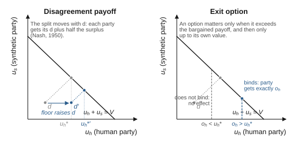
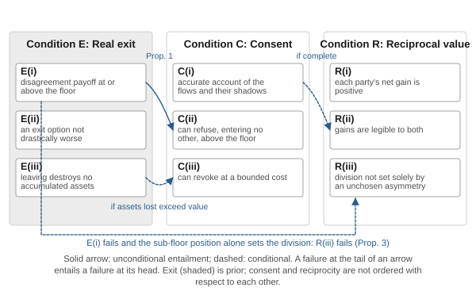
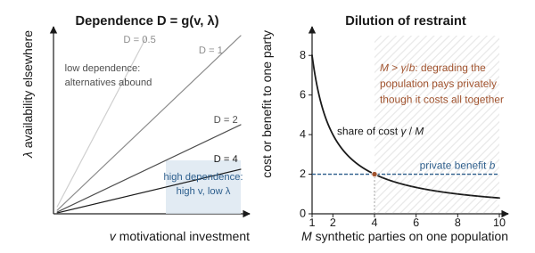
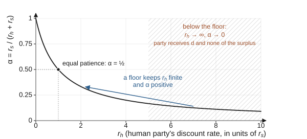
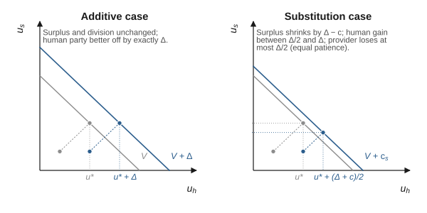
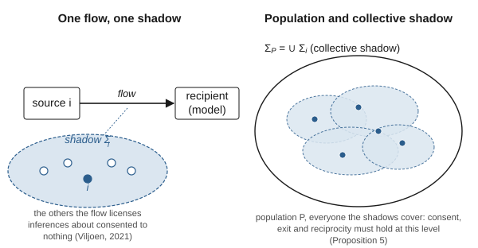
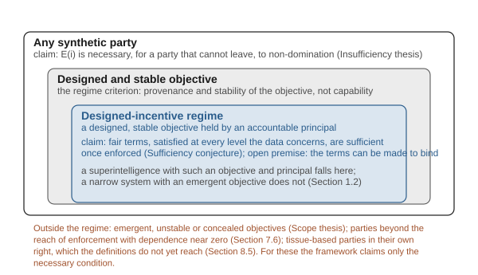
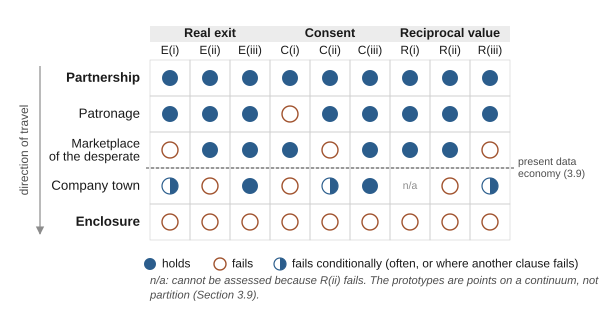

# Chapter 3: A Formal Statement of Synthetic Exchange Theory

The two preceding chapters argued in prose that the line between a good and a bad future with synthetic intelligence is drawn by the terms of exchange and cannot be drawn by the character of the systems alone. Prose permits a claim to be read more broadly when it is being defended than when it is being tested. This chapter therefore states the theory in a form whose content is fixed: a small vocabulary of defined terms, a set of propositions that follow from them, and a typology of exchange regimes that later chapters use as a diagnostic instrument. The formalism is deliberately modest. It is not a general equilibrium model of a post-labor economy, and it does not claim a precision the subject cannot bear. Its purpose is to make the dissertation's commitments explicit enough that a reader can see exactly where they would fail.

## 3.1 Why a formal statement is needed

Three ambiguities in the informal statement of the thesis justify the effort.

The first concerns the word *character*. The informal claim that outcomes depend on terms rather than character can be read as a strong claim, that a system's dispositions are irrelevant, or as a weak claim, that dispositions are insufficient. The strong claim is false: a system that actively seeks to deceive its counterparties will corrupt any institution it is placed inside. The weak claim is true but uninformative. The formal statement locates the thesis between them, which is why the thesis is stated as "cannot be drawn by the character of the systems alone." Character is treated as one input into the exchange, the agent's objective, and the terms are treated as the structure that determines how that objective translates into behavior. The thesis then becomes a claim about which of the two inputs institutional design can act on, and about the regime in which, once the terms bind, acting on them can be expected to suffice.

The second ambiguity concerns the relationship among the three conditions. In Chapter 1, consent, reciprocal value and real exit were introduced as tests that an exchange either passes or fails. They are not independent tests. Section 3.4 shows that consent leans on exit, that exit bounds reciprocity from below, and that the three are partially ordered, with exit prior to the other two.

The third ambiguity concerns power. The informal argument says that humans retain leverage because synthetic systems need their data. Leverage is a relational quantity, and it can be measured, at least in principle, by the dependence of each party on the other. Stating the argument in the vocabulary of power-dependence theory makes visible the dissertation's most important conditional: the framework is partly self-enforcing, to a degree that increases with the dependence of each synthetic party on human-generated input, and only while that dependence remains material. When it falls, or when it is spread so thinly across many synthetic parties that none of them bears the cost of degrading its human counterparties, the framework's institutions must carry weight that the underlying exchange no longer carries. Chapter 7 returns to this as the first of its limitations.

## 3.2 Lineage: exchange as the unit of social analysis

The theory's name places it in a tradition. Social exchange theory, as developed in sociology and social psychology in the middle of the twentieth century, treated social life as the exchange of rewarding and costly activity between actors, and asked what structures of exchange produce stable, cooperative or exploitative relations (Blau, 1964; Homans, 1958; Thibaut & Kelley, 1959). Its most consequential contribution for present purposes is Emerson's (1962) analysis of power as relational; in his words, power "is a property of the social relation; it is not an attribute of the actor" (p. 32). The power of one actor over another equals the dependence of the second on the first, and dependence rises with the value the dependent actor places on what the relation supplies and falls with the availability of that value from outside the relation. Power, on this account, is not a trait. It is a consequence of the structure of alternatives.

That is the move this dissertation makes about synthetic intelligence. Much of the public and technical conversation about advanced synthetic intelligence, on this dissertation's reading of it, treats the danger as residing in the system, in its goals, its dispositions, its capability to deceive or to seize resources. Those concerns are real, and the alignment literature that addresses them is engaged in Chapters 5 and 7. But the exchange-theoretic tradition suggests a complementary diagnosis: much of what would make a world with powerful synthetic systems dystopian is not a property of the systems at all but a property of the relations in which humans are placed with respect to them. A person with no alternative to a single provider of medical monitoring, whose refusal to share data would cost them their health, is in a relation of extreme dependence regardless of whether the provider is benevolent. A provider in that relation holds power whose use is restrained by nothing but its own disposition, and the relation is secure only while that disposition persists.

The constitutional tradition reaches the same conclusion from another direction. Hume (1741/1987, pp. 42–43) defended the maxim that in designing institutions every person should be supposed a knave, not because he believed people were knaves but because institutions that work only when their occupants are virtuous fail at the moment virtue fails. Madison (1788) made the same argument in *Federalist* No. 51: if people were angels no government would be needed, and since they are not, the design task is to arrange the structure so that ambition counteracts ambition. Synthetic Exchange Theory extends this constitutional insight across a new boundary. Its governing maxim is that in designing the terms of exchange between people and synthetic systems, neither party should be supposed benevolent. The terms must be such that a self-interested system, dealing with self-interested people, produces outcomes that both could endorse.

## 3.3 Primitive terms

The theory uses six primitive terms. Each is defined to be substrate-neutral, in keeping with the choice of the word *synthetic* over alternatives such as *symbiotic* or *human–AI*: the framework must apply without modification to biological humans, artificial systems and the hybrids discussed in Chapter 8; Section 8.5 records what Chapter 3 does not yet supply for tissue-based parties in their own right.

**Party.** A party is any entity that can be a source or recipient of value in an exchange and whose welfare, or whose principal's welfare, the framework counts. A human being is a party. A synthetic system is treated as a party in the analytic sense that it has an objective that the exchange advances or frustrates; whether it is also a party in the moral sense, an entity whose welfare counts for its own sake, is left open in this chapter and taken up in Chapter 8. The propositions below hold for parties in the analytic sense regardless of how the moral question is resolved.

The phrase "or whose principal's welfare" carries more weight than its brevity suggests, and it requires an account of who the synthetic party is. In present law, a deployed model is not a legal person and does not own anything, and the question whether one could be has been examined as a hypothetical rather than as doctrine (Solum, 1992). As Section 1.2 stated, it is not an independent living entity but an artifact that runs when its operator runs it. The entity with interests that can be advanced or frustrated is therefore the operator or developer that trains, deploys and profits from it. The relation between that operator and its system is a principal–agent relation of an unusual kind. The principal sets the system's objective through training and deployment, the agent pursues that objective with considerable autonomy in each exchange, and the agent's conduct may diverge from what the principal intended (Hubinger et al., 2019). This dissertation therefore treats the synthetic party as a composite: its *objective* is the model's, as trained and deployed, but its *stake* in the future of the exchange, its revenue, its access to data, its liability, belongs to the principal. Three consequences follow. Proposition 4 below concerns the principal's dependence on human input, transmitted to the system only to the extent that the principal writes it into the system's objective. The redemption obligation of Chapter 4 binds the owners of compute capacity, which, where a principal owns the capacity that runs its system, is the principal; a trained artifact cannot be made to honor it. And the question of how to count synthetic parties, which Chapter 5 cannot avoid, is a question about principals and about systems at once. It is made harder by the possibility that advanced synthetic intelligence is better modeled as a collection of bounded services than as a unitary agent (Drexler, 2019), in which case there may be no single system to which the label "party" naturally attaches. If the question of a system's own moral status, which Chapter 8 argues may eventually become live, were answered in the system's favor, the composite would come apart and the system would become a party in its own right.

**Flow.** A flow is a transfer of something of value from one party to another: data, labor, attention, compute, physical goods, services or tissue. Each flow has a source, a recipient, content and an informational shadow, meaning the set of parties, the source among them, about whom the recipient can draw inferences from the flow. The informational shadow is what makes data relational (Viljoen, 2021) and is the reason individual consent cannot by itself legitimate a flow.

**Exchange.** An exchange is a pair of opposing flows between two parties, or between a party and a collective, that each party enters because of the other flow. The defining feature of an exchange, as distinct from a gift or a taking, is conditionality: each flow is given because the other is received.

**Floor.** A party's floor is the bundle of goods and services without which the party cannot continue to function or to participate in any other exchange. For a human being, the floor is survival and basic participation, and this dissertation fixes its contents once, here, as power, water, food, shelter, basic communication and emergency care. For a synthetic party, the analogue is the minimum of energy, substrate upkeep and data required to keep operating; for a present artificial system, that is compute, energy and data. The floor is defined physically rather than in currency. Its value at current prices, which Appendix A writes $\bar f$, is what a person's disagreement payoff must reach for the conditions below to hold. Chapter 4 therefore delivers the floor through a survival tier that is a percentage of each allocation, so that it grows with the economy, subject to a binding physical minimum, so that it does not fall below the bundle it exists to secure. That guarantee holds while the agreed share of capacity can buy the bundle; Chapter 4 and Appendix A state the case in which it cannot.

**Disagreement payoff.** A party's disagreement payoff is what that party receives while an exchange is not taking place, that is, during refusal, negotiation or impasse. Bargaining theory shows that the division of the gains from an exchange depends on the parties' disagreement payoffs (Nash, 1950, pp. 158–159). A party whose disagreement payoff is below its floor cannot afford to disagree for long and therefore cannot bargain at all.

**Exit option.** A party's exit option is the best alternative exchange available to it if the current one ends: another provider, another employer, another data purchaser or self-provision. The distinction between a disagreement payoff and an exit option carries design consequences. Strategic bargaining models and laboratory evidence show that an outside option affects the terms of a bargain only when its exercise is credible, that is, only when the party would actually take it, whereas the payoff received during impasse shapes the bargain continuously (Binmore et al., 1986; Binmore et al., 1989). When the option binds, the weaker party receives exactly the option's value, which is then more than it would otherwise have obtained; the option therefore protects only up to its own value, and that value can be lowered by the counterparty through switching costs until the option no longer binds and protects nothing. A disagreement payoff that cannot be taken away is a protection of a different kind, because it moves the bargained share itself and does not depend on anyone's willingness to leave. The non-tradable survival tier of Chapter 4 is designed to be such a payoff. Figure 3 shows the difference in the bargaining set.

**Figure 3**

*A Disagreement Payoff Moves the Bargained Share; an Exit Option Only Bounds It*

*Note.* Both panels plot the feasible frontier on which the parties' payoffs sum to the joint value of agreement. Left: raising the human party's disagreement payoff from d to d′ moves the Nash solution along the frontier toward the human party (Nash, 1950). Right: an outside option changes the outcome only when it exceeds the bargained payoff, and then the human party receives exactly the option's value (Binmore et al., 1989); the counterparty can lower that value by raising switching costs, which it cannot do to a payoff received during impasse. The points are illustrative.

## 3.4 The three conditions, stated precisely

With the primitive terms in hand, the three conditions of Chapter 1 can be restated so that each has a determinate content and the relations among them become visible.

**Condition E (Real exit).** An exchange satisfies real exit for a party if and only if (i) the party's disagreement payoff is at or above its floor, (ii) the party has at least one exit option whose value net of switching costs is not drastically lower than the value of the current exchange, and (iii) exercising the exit option does not destroy assets the party has accumulated within the exchange, including data, reputation and records of entitlement. Clause (i) rules out lethal dependency. Clause (ii) rules out lock-in. Clause (iii) is the portability requirement, and it is what data-portability rights in existing law attempt to secure (Regulation [EU] 2016/679, art. 20; Regulation [EU] 2023/2854).

**Condition C (Consent).** An exchange satisfies consent for a party if and only if (i) the party has access to an accurate account of the flows the exchange involves, including their informational shadows, in a form the party can understand; (ii) the party can refuse the exchange, entering no other in its place, without falling below its floor, which is to say that its disagreement payoff is at or above its floor; and (iii) the party can revoke its participation at a cost bounded by the value of what it has already received. Clause (i) is the informational condition that privacy scholarship has shown to be routinely unmet (Acquisti et al., 2015; Solove, 2013). Clause (ii) is where consent depends on exit, and its wording matters: a party that could avoid falling below its floor only by switching to another provider has an exit option, not a disagreement payoff at the floor, and the clause requires the latter, for the reason Section 3.3 gave. Clause (iii) adds the temporal dimension: consent that cannot be withdrawn is a sale.

**Condition R (Reciprocal value).** An exchange satisfies reciprocal value if and only if (i) each party's net gain from the exchange, measured against its disagreement payoff, is positive; (ii) each party can observe what it receives and what it gives, so that the gains are legible; and (iii) the division of the joint surplus is not determined solely by an unchosen asymmetry in the parties' bargaining positions, whether in their disagreement payoffs or in their capacity to wait. Clause C(i) concerns the content of the flows and their shadows; clause R(ii) concerns their value, and the two can fail separately. Clause R(iii) is the fairness clause, and it is the clause that requires governance, because the market alone will divide surplus according to bargaining power. It is needed because, as the philosophy of exploitation has shown, an exchange can be consensual and beneficial to both sides and still take unfair advantage of one of them (Zwolinski et al., 2022). The standard adopted here is the one the exploitation literature reports: the division that would obtain in a competitive market free of informational asymmetry and undue pressure (Zwolinski et al., 2022). A division that departs from that benchmark because one party's disagreement payoff lies below its floor, because one party can outwait the other on an accumulated stock, or because of structural bargaining power the weaker party did not choose, such as concentration or lock-in, fails the clause; the floor corrects the first of these, and the residue is what governance must address. A division that reflects the parties' genuine alternatives above the floor does not fail it. Mutual benefit is the minimum reciprocity requires, not its standard.

With the conditions stated this way, their structure becomes clear.

> **Proposition 1 (Exit primacy).** Consent presupposes the first clause of exit. If a party's disagreement payoff is below its floor, then no agreement that party gives satisfies Condition C, however well informed it is.

The derivation is immediate because the definitions were drawn to make it so: clause C(ii) requires that refusal, with no other exchange entered in its place, leave the party at or above its floor, which is E(i). The proposition's real content is the claim that C(ii), so worded, belongs in any adequate definition of consent: that a party able to refuse one provider only by submitting to another has not been given the ability to refuse. The unconditional floor of Chapter 4 is designed to supply the disagreement payoff the clause requires. The proposition formalizes a point that the bioethics literature on informed consent has long made in its own terms: that information is necessary but not sufficient for valid consent (Faden & Beauchamp, 1986, pp. 241–273; Manson & O'Neill, 2007), and that agreement given under the threat of losing something one cannot do without is not substantially free of controlling influences, which is the condition of voluntariness in Faden and Beauchamp's account (Faden & Beauchamp, 1986, pp. 241–273, 277–280). Its practical implication is that no amount of improvement in notice, disclosure or interface design can repair a consent regime whose subjects cannot afford to refuse. The policy effort directed at better privacy notices is not wasted, but it is directed at clause C(i) while the binding constraint is often clause C(ii). The definition has a consequence that should be stated. Under it, consent to a service without which a person cannot live is valid only where the service's continuation is secured independently of the consent, a guarantee that, on this dissertation's reading, existing institutions do not give in general; a patient who can choose among providers of such a service but cannot refuse it altogether has, on this definition, an exit option and not the ability to refuse. The framework accepts that verdict, and it is the reason the floor includes emergency care and the requirement of Chapter 8 that a baseline of function survive a change of provider must cover life-sustaining devices.

> **Proposition 2 (Reciprocity as the reason to stay).** If Condition E holds, switching costs are negligible, and the party can observe its gain (clause R(ii)), then a party that acts in its interest remains in an exchange only if its payoff in the exchange is at least the value of its best exit option; since that option is itself an exchange the party would enter only if it at least matched its disagreement payoff, the party's net gain is non-negative in every exchange in which it persists, and so is each party's where the premises hold for both, which is clause R(i) with its strict inequality relaxed. Strict reciprocity requires that the best alternative itself better the disagreement payoff, which clause E(ii) does not guarantee. Reciprocity in its first clause is then not an independent ethical requirement imposed on top of exit; exit bounds it from below. Its fairness clause is not so bounded.

When a party can leave at negligible cost and can see what it gains, it will leave an exchange that leaves it worse off than its alternatives. An exchange that persists under such conditions therefore reveals that the party is not losing value relative to its alternatives. Where switching costs are material, a party may rationally remain in an exchange that gives it nothing beyond what it would get on impasse, because leaving would cost more than staying; this is the gap that clause E(ii) is meant to keep small. The converse is the diagnostic that matters: an exchange that persists while delivering negative value to one party is evidence that clause E(ii) is failing for that party, or that the party cannot see what it gains, which is a failure of clause R(ii). Persistence without legible reciprocity is a symptom either of lock-in or of opacity.

> **Proposition 3 (The triad is partially ordered, with exit prior).** Violations of the three conditions differ in how much damage they do and in whether they can be corrected from inside the exchange. A violation of the first clause of exit entails a violation of clause C(ii) and, where the sub-floor position is unchosen and determines the division by itself, of clause R(iii); clauses R(i) and R(ii) may still hold. A violation of the second or third clause of exit leaves the other conditions intact at the moment of exchange but removes the means of correcting their later failure; the one exception is that a violation of clause E(iii) carries a violation of clause C(iii) with it where the assets destroyed on leaving exceed the value received. A violation of the revocability clause of consent, with exit intact, is correctable by exit; a violation of the voluntariness clause is a violation of exit itself, by Proposition 1; a violation of the informational clause is correctable by exit only once the party knows enough to want to leave. A violation of reciprocity in its first two clauses, with consent and exit intact, is corrected by departure, unless the same violation is common to every available alternative. A violation of clause R(iii) is only partly corrected by exit: the floor removes the asymmetry that comes from a disagreement payoff below the floor, and an outside option bounds the division from below, but neither determines the division of the surplus that remains, which follows from bargaining power that the party did not choose and that governance alone can address.

The ordering the proposition establishes is partial. Exit is prior to the other two conditions because its failures cannot be corrected from inside the exchange; consent and reciprocity are not ordered with respect to each other, since, among the clauses of those two conditions, the fairness clause is the least correctable by departure and the first two clauses of reciprocity the most. The priority is one of correctability from inside the exchange, and the design conclusion drawn below needs only the priority of the floor clause. The qualifications matter. When every provider of a service shares the same defect, departure is what Hirschman (1970) showed exit to become under industry-wide decline: ineffective movement between alternatives that are equally bad. And the fairness clause of reciprocity is only partly within the reach of exit. Even so, the ordering survives as a statement of priority, and it is the dissertation's principal reason for designing the economic layer around a guaranteed floor rather than around better pricing of data. Pricing addresses reciprocity. The floor addresses exit. If the order is right, the floor comes first, and governance is needed for what neither can reach. Figure 4 shows the nine clauses and the dependencies among them.

**Figure 4**

*The Three Conditions, Their Nine Clauses, and the Dependencies Among Them*

*Note.* An arrow runs from a clause whose failure entails the failure of the clause at its head. Solid arrows are unconditional (Proposition 1); dashed arrows hold under the stated condition. Exit is prior because its failures cannot be corrected from inside the exchange (Proposition 3); consent and reciprocity are not ordered with respect to each other.

## 3.5 Power and the grounding assumption

The second analytic tool is Emerson's (1962) definition of power as dependence. For two parties *A* and *B*, let the dependence of *B* on *A* increase with *B*'s valuation of what the relation with *A* supplies and decrease with the availability of that value from parties other than *A*. The power of *A* over *B* equals the dependence of *B* on *A*. The relation is balanced when the two dependences are equal and unbalanced otherwise. Of the four ways in which Chapter 2 showed an unbalanced relation can be rebalanced, three have direct analogues in the design that follows. The survival tier and the portability requirements extend the human party's network, by making floor goods and records available independently of any single provider; the same tier makes possible a measure of withdrawal, since a person whose floor is secured can afford to care less about what any one provider offers; and data cooperatives and the collective-choice arrangements of Chapter 5 are coalition formation.

The grounding assumption plays a different role. It is not a rebalancing operation at all but a statement about dependence running the other way: it asserts that synthetic parties need something only people can supply, and so that the relation is less unbalanced than it appears. This reformulation makes the dissertation's central empirical premise precise, and it also exposes a difficulty the informal argument concealed.

> **Proposition 4 (Conditional and divided self-enforcement).** Let $\kappa_j$ denote the dependence of synthetic party $j$, through its principal, on the human-generated input of a given population. Party $j$ has a reason to preserve that input, to a degree that increases with $\kappa_j$, provided that the principal's dependence is written into the system's objective and that the principal weighs the future value of its inputs against present gains. That reason makes fair terms partly self-enforcing only insofar as the quality of the population's input depends on the terms the population receives: because a population that can refuse and leave can withhold what the party needs, and because, on this dissertation's inference, contribution under domination narrows toward what the dominant party extracts and loses the variety that gives it value. Where input can be extracted on unfair terms without loss, dependence protects the supply and not the terms. As $\kappa_j$ falls toward zero, the self-enforcing component vanishes. When many synthetic parties draw on the same population, the welfare and data quality of that population become a common-pool resource for them: each bears only its own share of the cost of degrading it, so that the incentive of any one party to preserve it can be small even when the dependence of all of them together is large.

The research on recursive training reviewed in Chapter 2 bears directly on the size of $\kappa_j$. If models trained on their own outputs lose the tails of the distribution and drift (Shumailov et al., 2024), human data has a value that synthetic data cannot replace. If, as other work suggests, accumulation of real data alongside synthetic data (Gerstgrasser et al., 2024; Kazdan et al., 2024), or a modest continuing supply of fresh real data (Alemohammad et al., 2024; Shumailov et al., 2024), is sufficient to prevent collapse, though at least one formal result requires that supply to grow in proportion to the synthetic data (Dohmatob et al., 2025), then dependence is positive but small, and the human party's leverage is correspondingly modest. Proposition 4 is written so that the framework does not stake its normative conclusions on the most favorable reading of that literature. Two of its premises deserve emphasis because they are easy to pass over. The first is that the withholding by which a population disciplines terms presupposes that the population can refuse and leave: self-enforcement is therefore a support for the institutions that secure exit, not a substitute for them, which is the sense in which Chapter 7 calls it a support and not a foundation. The second, that extracted contribution loses value, is the dissertation's inference from the grounding assumption as Chapter 2 narrowed it, since the domains in which people are the only adequate source are those of meaning, preference, value and culture, and it is argued, not shown.

The second half of the proposition matters as much as the first. It is Hardin's (1968) logic of the open-access commons applied to the synthetic side of the exchange: aggregate dependence on people does not translate into individual restraint by any synthetic party when each can free-ride on the restraint of the others. This does not weaken the case for the framework. It strengthens the case for its governance layer, because a commons is what the institutions of Chapter 5, grounded in the record of how commons are governed, are designed to protect. The result also exposes a tension within the design. Exit requires many synthetic parties; self-enforcement is strongest when there is one. The framework resolves the tension in favor of exit, and therefore cannot rely on self-enforcement in the competitive market it seeks to create; the governance layer must carry that weight, and Chapter 7 records this as a limitation. The institutional layers of Chapters 4 and 5 are therefore built to hold whether dependence is small, or large but divided. What changes as dependence falls or fragments is not the justification of the institutions but the degree to which they can rely on the self-interest of synthetic parties to sustain them. Figure 5 shows both halves of the proposition.

**Figure 5**

*Dependence Rises With Value and Falls With Availability; Divided Among Many Parties, It Loses Its Restraining Force*

*Note.* Left: contours of D = v/λ, one admissible form of Emerson's (1962) dependence function; dependence is high where investment is high and alternatives are few. Right: the share γ/M of a collective cost γ borne by one of M synthetic parties, drawn with γ = 8 and b = 2; once M exceeds γ/b, degrading the population pays privately although it costs all of them together (Appendix A.5; Hardin, 1968). The parameters are illustrative.

## 3.6 Bargaining, the floor and the logic of the economic layer

The third analytic tool is bargaining theory, which supplies the formal reason for the most distinctive features of the economic design. Appendix A gives the derivations.

Consider an exchange between a human party *h* and a synthetic party *s* that creates a joint surplus. In the axiomatic solution to the two-party bargaining problem, the surplus is divided so as to maximize the product of each party's gain over its disagreement payoff (Nash, 1950, p. 159). Strategic bargaining models in which parties alternate offers converge to this solution as the frictions of delay vanish, provided the disagreement point is chosen to reflect what parties receive while negotiations are under way, and in those models each party's impatience is part of what determines the outcome (Binmore et al., 1986). When the outside option is instead an alternative a party may or may not take, it affects the outcome only when it binds (Binmore et al., 1989).

The most important consequence for policy concerns impatience. If, as the floor's definition implies, payoffs below it carry a cost of delay that rises sharply (a survival constraint the Nash model does not itself contain), a party whose disagreement payoff lies below its floor cannot sustain disagreement for longer than its reserves allow; in a model of alternating offers it behaves as a party with a very high cost of delay, and such a party concedes. Raising the disagreement payoff to the floor removes this source of weakness, and it does so in every bargain the party enters, not because the floor is added to each bargain separately but because it is the background against which each is conducted. This is the main bargaining-theoretic reason for the floor, and it does not depend on whether the tier substitutes for anything the counterparty supplies, though it does depend on the survival constraint just stated. Figure 6 plots the bargaining weight against the human party's discount rate.

**Figure 6**

*Impatience Below the Floor Drives the Human Party's Share of the Surplus Toward Zero*

*Note.* The weight α = r_s/(r_h + r_s) is the limit of the alternating-offers model with unequal discount rates (Binmore et al., 1986), drawn for a fixed r_s. The survival constraint that sends r_h to infinity for a party below its floor is a stated assumption (Appendix A.3.2); under it the party receives its disagreement payoff and none of the surplus. A floor keeps r_h finite and α positive.

A second consequence concerns the division of surplus, and here the intuitive version is wrong. Holding the value of agreement fixed, raising one party's disagreement payoff raises that party's share of the agreement. But an unconditional floor, received whether or not agreement is reached, raises both the party's payoff on disagreement and its payoff on agreement by the same amount. It therefore leaves the surplus, and its division, unchanged: the party is better off by exactly the value of the floor, no more. The floor lowers the counterparty's payoff only where it substitutes for something the counterparty would otherwise have supplied within the exchange, for example where a person who once had to buy floor goods from a provider now receives them through the survival tier; in neither case does it change how the remaining surplus is divided. In the substitution case the disagreement payoff rises while the joint surplus the exchange must create shrinks, because part of what the provider supplied is no longer needed. Appendix A shows that, when the provider's cost of supplying those goods does not exceed their value to the person and the parties are equally patient, the person's net gain from a tier worth a given amount lies between half that amount and the whole of it, and the provider's payoff falls by at most half the tier's value; under unequal patience the fraction one half is replaced by the provider's bargaining weight. Where the provider's cost of supplying floor goods exceeds their value to the person, as it may where a provider supplies them in order to create dependence, the surplus grows instead and both parties gain. The substitution case is therefore not a benefit beyond the tier. It is the case in which part of the tier's value is absorbed by the shrinkage of a surplus the exchange no longer needs to create, and the fall in the provider's payoff is the reduction in dependence that power-dependence theory predicts when an alternative source of a valued good appears. Figure 7 shows the two cases.

**Figure 7**

*What an Unconditional Floor Does to the Division of Surplus: The Additive and Substitution Cases*

*Note.* Drawn with V = 10, d = (2, 2), Δ = 3 and c_s = 1 under a symmetric Nash split (Appendix A.3.1). Left: the floor raises the human party's disagreement payoff and the joint value by the same Δ, so the division is unchanged and the human party is better off by exactly Δ. Right: the floor replaces goods the provider supplied at cost c_s, the surplus shrinks by Δ − c_s, the human party gains between Δ/2 and Δ, and the provider's payoff falls by at most Δ/2. The working draft's claim of a Δ/2 gain in every bargain was the substitution case misread as general.

Three design consequences follow.

**First, the floor should be paid as a disagreement payoff, not offered as an exit option.** A floor that is received whether or not one participates in any given exchange is received during every impasse, and so removes the impatience that would otherwise force concession. An exit option, by contrast, protects the weaker party only up to its own value, which the stronger party can lower by raising switching costs. This is why the economic layer delivers survival goods through an automatic, unconditional earmark, backed by the acceptance obligation of Section 4.5, rather than through a guarantee that a person may seek them elsewhere.

**Second, the floor must be inalienable.** A disagreement payoff that can be sold, pledged or borrowed against can be traded away in a moment of need, after which it no longer functions as a disagreement payoff. Legal theory distinguishes entitlements protected by property rules, which may be transferred with the holder's consent, from entitlements protected by inalienability rules, which may not be transferred even with consent (Calabresi & Melamed, 1972, p. 1092). Radin (1987) argued that some goods should be market-inalienable because their commodification threatens the personhood of those who hold them, although she also warned that, in a nonideal world, prohibiting sale can harm the very people it is meant to protect, a dilemma she proposed to mediate through incomplete commodification. The survival tier is designed to respect that warning: it forbids no one to sell what they already have, and instead adds an entitlement that cannot be sold. The survival tier is the application of inalienability to the disagreement payoff. It is non-tradable and non-borrowable not because the framework distrusts its beneficiaries but because a floor that can be alienated stops being a floor at the moment it is needed (Appendix A.3.3).

**Third, accumulated balances are bargaining power, and their accumulation should carry a cost.** A party that holds a large stock of the exchange medium can afford to wait in every exchange it enters. In a two-tier system, the survival tier secures every party's disagreement payoff at the floor, but the discretionary tier can reintroduce inequality above it, and inequality of stocks is inequality in the capacity to wait. A holding cost on idle balances, demurrage, is one part of the instrument that acts on this channel; Section 4.6 shows that without a rule on capacity it has no distributive effect of its own. It lowers the advantage associated with merely holding wealth while leaving untouched the returns to putting it to use. Chapter 4 develops the history and the limits of this instrument. The formalism does not derive this third consequence: in Appendix A, a stock enters the bargain only through the survival constraint, and the link between accumulated balances and the capacity to wait above the floor is an inference from the model's logic rather than a result in it.

The bargaining frame thus connects the three main elements of the economic layer. The survival tier secures every party's disagreement payoff at the floor, wherever the agreed share of capacity can buy it and the floor goods can be obtained for the unit (Section 4.5), and so removes the impatience that would otherwise force concession. Its inalienability prevents that payoff from being bargained away. Demurrage, with the capacity rules of Chapter 4, dampens the conversion of accumulated stocks into a superior capacity to wait. None of these elements was introduced for this reason when the design was first sketched; the formalism reveals a coherence in the first two that the design already had, supplies the logic though not a derivation of the third, and corrects an overstatement about where the floor's bargaining effect comes from.

## 3.7 Collective consent and the problem of the informational shadow

The fourth analytic problem is the one the consent literature regards as most serious for any individual-choice framework. Data about one person licenses inferences about others who resemble them. The flow from source to recipient therefore has an informational shadow that falls on people who did not consent to it (Barocas & Nissenbaum, 2014; Viljoen, 2021). If the shadow is large, the sum of individually valid consents can authorize a collective harm that no individual consented to.

Synthetic Exchange Theory responds by distinguishing two levels at which each condition must hold. At the *individual level*, the conditions govern a person's relation to a provider. At the *collective level*, they govern a population's relation to the synthetic systems that learn from it, where the population is defined by the extent of the informational shadow, that is, by the set of people about whom the system can draw inferences from the data in question. Collective consent requires a collective-choice procedure. Collective exit requires that the population, as a body, be able to withdraw its data or move its custody. Collective reciprocity requires that the population, as a body, share in the value the data creates.

> **Proposition 5 (Level matching).** An exchange whose informational shadow extends beyond its source satisfies the three conditions only if they are satisfied at the level of the population that the shadow covers. Individual consent is necessary for individual flows and insufficient for relational ones.

Proposition 5 is a requirement the framework imposes rather than a result derived from the definitions, and it needs the collective-level conditions to be given content, since Conditions E, C and R were defined for a party to an exchange. The framework gives them the following content. The population's floor is the floor of each of its members. Its disagreement payoff is what its members receive while the population, acting through the collective-choice institutions of Chapter 5, withholds its data. Its exit option is the transfer of the custody of future flows to another steward, through the institutions Chapter 2 reviewed. Its consent and its share of value are exercised and received through those same institutions. Because almost any informative flow casts some shadow beyond its source, the shadow that triggers the requirement is the set of parties about whom the flow materially changes what the recipient can infer, and the threshold of materiality is a parameter the governance layer must set; without it, no individual exchange about population-descriptive data could ever satisfy the conditions in full. Figure 8 shows the shadow of a single flow and the collective shadow of a population.

**Figure 8**

*The Informational Shadow of a Flow and the Level at Which Consent Must Be Given*

*Note.* Left: a flow from source i licenses inferences about a set of parties, its shadow Σ_i, which includes i and others who consented to nothing (Viljoen, 2021). Right: the collective shadow of a population is the union of its members' shadows, and Proposition 5 requires the three conditions at that level, above the materiality threshold the governance layer sets (Appendix A.6).

The proposition is not novel in substance; it is the formal core of arguments for data trusts, data cooperatives and collective bargaining over data (Ada Lovelace Institute, 2021; Delacroix & Lawrence, 2019; Hardjono & Pentland, 2019). What the theory adds is a rule for locating the right level, namely the extent of the informational shadow, and a conjecture about where collective institutions will be needed most. The information-gain pricing of Chapter 4 values data by how much it reduces a model's uncertainty about its parameters. Where those parameters describe populations rather than individuals, which is the usual case for the models that matter here, data that reduces uncertainty most is data that tells the model most about people other than its source. If so, the highest-priced flows will tend to be those for which individual consent is least adequate. The conjecture can fail: a flow that is highly informative about a single rare individual may carry a high price and a small shadow. But to the extent that it holds, the economic and governance layers must be designed together.

Hirschman's (1970) analysis of exit and voice supplies the remaining link. Where exit is costly, members of an organization fall back on voice, the attempt to change it from within; where exit is easy, voice can atrophy. At the collective level, exit is usually costly, because a population cannot easily withdraw its data from a model already trained on it. The collective-level conditions must therefore be secured primarily through voice, which is the role of the governance layer, and secondarily through custody arrangements that make collective exit at least possible for future flows. This qualifies the reach of Proposition 3 at the collective level. The ordering holds, but the exit it places first is secured there through voice, the collective-choice institutions of Chapter 5, rather than through departure, since a population cannot withdraw data already absorbed into a trained model; and the partnership regime of Section 3.9 is reachable for population-descriptive data only for future flows whose custody can be moved.

## 3.8 Character, terms and the scope of the thesis

The formal apparatus now permits a precise statement of the central thesis.

Let a synthetic party's behavior in an exchange be determined by two things: its objective, meaning the function its training and deployment have made it optimize, which Section 1.2 and the composite definition of Section 3.3 locate in the trained artifact and its principal, and the terms of the exchange, which determine what it can obtain by which actions. Call the objective the party's *character* in the sense relevant to the thesis. Call the terms the *institutional structure*. A relation is one of *domination*, in the sense this dissertation gives the word, when one party's outcome depends on the other's will and the first cannot alter that dependence. The definition is symmetric in form: it applies with the roles exchanged, so that a synthetic party in its own right, or the principal in whom a system's stake resides, is dominated when its outcome depends on a human party's will that it cannot alter; for a system that is not a party in its own right, control names the principal's relation to its artifact, not a relation between parties. Call the class of synthetic parties whose objectives are specified by accountable designers and remain stable in deployment the *designed-incentive regime*. The thesis has three parts.

> **Thesis (Insufficiency of character).** Benevolent character is not sufficient for an outcome whose persistence the weaker party can secure, and clause E(i) of Condition E, a disagreement payoff at or above the floor, is necessary, for a party for which clause E(ii) also fails, to any relation that is not one of domination. An exchange in which the human party's disagreement payoff lies below its floor and which it cannot leave is a relation of domination even if the dominant party is benevolent, because the outcome then depends on the persistence of benevolence, which the weaker party cannot secure. Where the sub-floor party has an exit option that satisfies clause E(ii), no single counterparty's will determines its outcome and it is not dominated in the stipulated sense; it is exposed instead to the erosion of its options described in Section 3.3, which is why the framework secures clause E(i) rather than relying on clause E(ii). A failure of clause E(ii) or E(iii) alone leaves the party dependent for its surplus but not for its survival, and the party can alter that dependence by withdrawing to its floor; such a failure is a defect of the exchange, not a relation of domination.

> **Thesis (Sufficiency conjecture in the designed-incentive regime).** For synthetic parties whose objectives are specified by accountable designers and remain stable under the conditions of deployment, fair terms, satisfied at the individual level and, under Proposition 5, at the level of every population the exchange's informational shadow reaches, are sufficient for outcomes acceptable to the human parties and to the principals of the synthetic parties to the exchange.

> **Thesis (Scope).** The sufficiency conjecture does not extend to synthetic parties whose objectives are emergent, unstable or concealed. For such parties the framework provides only the necessary condition of the first thesis, and the alignment problem remains open.

The first thesis is the reason the dissertation rejects a frame in which safety is achieved by making systems good and leaving relations of total dependence in place. Its argument is the one just given, and, as with Proposition 1, the necessity follows from the stipulated definition of domination; what the thesis asserts beyond the definition is that benevolence is not a substitute for the clause, because the weaker party cannot secure its persistence, and that an exit option is not a substitute either, because its value can be lowered by the counterparty (Section 3.3). It establishes the necessity of the floor clause of exit for the party that cannot leave, not of the full triad; the other clauses, and the other two conditions, are argued for as requirements of a fair exchange, not as conditions of non-domination. The second thesis is the reason the dissertation concentrates on institutional design, and it is offered as a conjecture rather than a theorem. Its content should be stated plainly. An accountable designer is one that can be identified and held to the obligations the terms create, the unique accountable principal of Chapter 5. The conjecture's ground is that a party with a stable, designer-specified objective behaves as a predictable function of the terms it faces, so that its conduct can be audited against those terms. Predictability does not by itself entail compliance: a stable revenue-maximizer is predictable and defects whenever defection pays. The conjecture's content is therefore that, for such parties, the three conditions once enforced are sufficient, and no further constraint on character is needed for outcomes the parties would re-enter; its open premise is that the terms can be made to bind, and Chapter 7 records that enforcement without a sovereign remains unsolved. The regime is also bounded by accountability: a system with a designed and stable objective but no principal who can be held to obligations is outside it until that problem is solved, so that for a superintelligence the constructive claims hold only while an accountable principal holds its stake. The regime criterion likewise presupposes a party with a principal; the tissue-based cases of Chapter 8, considered as parties in their own right, fall outside it on that ground. An outcome is acceptable, for the purposes of the conjecture, when each human party, from a position at or above its floor and with a comparable alternative available, would re-enter the exchange on the same terms knowing what it now knows, and each principal would continue to deploy under them; the qualification excludes the party that would re-enter only because it has nothing better. Predictability is not the same as acceptability, and it is the level-matching requirement that closes the gap: without it, a revenue-maximizing system operating under terms fair to its counterparty could still impose uncompensated costs on everyone its counterparty's data concerns. This dissertation does not test the conjecture; Section 3.11 names the proxies a test would need, and Chapters 7 and 9 say what it would require. The third thesis is the reason the dissertation restricts its constructive claims to the designed-incentive regime. The regime is not defined by capability; its defining feature is the provenance and stability of the objective: a narrow system can acquire emergent objectives, and a superintelligence could in principle have designed and stable ones. Figure 9 shows the scope of each of the three theses.

**Figure 9**

*The Scope of the Theory's Claims: Where the Necessary Condition Holds and Where the Sufficiency Conjecture Is Offered*

*Note.* For any synthetic party the theory claims only that clause E(i) is necessary, for a party that cannot leave, to a relation that is not one of domination. The sufficiency conjecture is offered only inside the designed-incentive regime, whose criterion is the provenance and stability of the objective together with an accountable principal, not capability. Parties outside it, and the tissue-based parties of Chapter 8 considered in their own right, receive only the necessary condition.

The two framing scenarios of Chapter 1, the integrated person who pays for medical care with continuous data and the person whose brain has become infrastructure, can now be described exactly. They share an architecture and differ in the terms. In the first, Conditions E, C and R hold. In the second, the failure of exit entailed the failure of consent, and the failure of both removed the only pressure that could have sustained reciprocity.

## 3.9 A typology of exchange regimes

Because each condition is a conjunction of clauses, and because the dependencies the chapter has established run at the level of clauses, the eight combinations of the three conditions do not sort exchanges usefully. Those dependencies are four: a failure of E(i) entails a failure of C(ii), by Proposition 1; a failure of E(i) entails a failure of R(iii) where the sub-floor position is unchosen and determines the division by itself, by Proposition 3; a failure of E(iii) entails a failure of C(iii) where the assets destroyed on leaving exceed the value received; and, a dependency the typology adds, a failure of C(i) so complete that the party cannot see what it gives at all entails a failure of R(ii), since what cannot be seen cannot be valued. The typology therefore names five prototypes by their clause pattern. They are points on a continuum rather than a partition; an exchange can answer to more than one description; and cases in which only clause E(ii) or E(iii) fails while the other conditions hold, such as the revocable purchase of Section 3.10, are the ones Proposition 3 treats as removing the means of later correction and the first thesis of Section 3.8 treats as defects of the exchange rather than as relations of domination, and they are not named. Later chapters use the names as shorthand.

| Regime | Exit | Consent | Reciprocity | Characteristic form |
|---|---|---|---|---|
| Partnership | All clauses hold | All clauses hold | All clauses hold | The target of the framework; the first scenario of Chapter 1 |
| Patronage | Holds | C(i) fails | Holds | Paternalistic provision: benefits delivered without an account of the flows' shadows or uses, though the recipient can see what it gives, on terms it can leave |
| Marketplace of the desperate | E(i) fails | C(ii) fails with it | R(i) and R(ii) hold; R(iii) fails | Value flows both ways and can be seen to, but the weaker party cannot afford to refuse |
| Company town | E(ii) fails, often E(i) | C(i) fails; C(ii) where E(i) fails | R(ii) fails, so R(i) cannot be assessed | Wages paid in a medium redeemable only with the payer; reciprocity cannot be audited and leaving is costly |
| Enclosure | All clauses fail | All clauses fail | All clauses fail | The second scenario of Chapter 1: the person has become infrastructure |

Two features of the typology deserve comment. First, on this dissertation's diagnosis, the present data economy does not sit at enclosure. Its typical exchange lies between the marketplace of the desperate and the company town: services are real and consent is formally collected, but declining is expensive, leaving is hard, and the terms are opaque to the people who accept them. The dystopia of Chapter 1 is therefore best read as the endpoint of a direction of travel rather than as a different world. Second, patronage is a failure mode of limited concern to the framework. A regime in which exit holds and only the informational clause of consent fails is correctable in the sense of Proposition 3, provided that its alternatives do not share its defect. The framework's design priorities follow from this: secure exit first, because it converts most other failures into ones that people can escape, and build governance for the failures that exit cannot reach. Figure 10 shows the five prototypes as a clause-level matrix.

**Figure 10**

*Five Prototypes of Exchange Regime by Clause Pattern*

*Note.* Filled cells mark clauses that hold, open cells clauses that fail, and half-filled cells clauses that fail often or where another clause fails; n/a marks a clause that cannot be assessed because R(ii) fails. The prototypes are points on a continuum rather than a partition, and the present data economy lies between the marketplace of the desperate and the company town (Section 3.9).

## 3.10 The typology applied

A theory is useful to the extent that it sorts cases that intuition sorts badly. Six cases, drawn from the literature reviewed in this dissertation, show the conditions and the typology at work: five chosen for the contrast they offer between a focus on character and a focus on terms, and one, the resource dividend, as the nearest existing analogue of the survival tier.

**The revocable purchase.** Retailers of digital goods have characterized purchases of books, music and films as licenses rather than sales, and in a well-known instance a retailer remotely deleted copies of a novel from customers' devices (Perzanowski & Schultz, 2016). Nothing about this exchange looks like coercion. Customers chose freely, received what they paid for, and could shop elsewhere. A character-centered analysis finds nothing to object to unless the seller acted in bad faith. The theory locates the defect: clause E(iii) of the exit condition fails, because leaving the seller, or the seller's leaving the market, destroys assets the customer accumulated within the exchange. The case is a small one, but it shows how an exchange can satisfy consent and reciprocity at the moment of transaction while carrying a latent exit failure that matures only later.

**The withdrawal of the web.** Within a single year, as Section 2.7 documented, a substantial share of the most actively maintained, critical sources of text used to train language models moved to restrict automated collection (Longpre et al., 2024). Viewed in terms of the parties' character, this looks like a dispute between publishers and developers over norms of conduct. Viewed through the theory, it is an exercise, collective and at scale, of the countervailing power that developers' dependence on such text confers. It is evidence that publishers believe their content is valuable to developers, and so bears on, without settling, the size of the dependence term in Proposition 4. It also shows the limits of the instruments currently available. A blanket refusal expressed in a protocol designed for search engines is exit without voice, which Hirschman (1970) argued to be an indirect signal of decline and which, where exit is easy, allows voice to atrophy.

**The company town.** Chapter 4 summarizes the economic history of company scrip in nonunion coalfields, which finds that store prices were often close to those of independent stores and that the degree of exploitation varied with how much competition the mine faced for labor (Fishback, 1992). A character-centered reading of this evidence concludes that the companies were less exploitative than the popular account holds. The theory draws a more specific conclusion: the same instrument was less exploitative where exit was available and more exploitative where it was not. The case illustrates clause E(ii): what the evidence ties to exploitation is the absence of an exit option. That a floor would have done the same work is the framework's inference from Sections 3.3 and 3.6, not a finding of the case.

**The kibbutz.** The Israeli kibbutz sustained an egalitarian internal economy within a market economy for much of the twentieth century. Its central difficulty was that the most productive members were the most likely to leave, and a key retention device was collective wealth that departing members could not take with them (Abramitzky, 2008). In the vocabulary of the typology, the kibbutz secured reciprocity and consent but compromised clause E(iii) of exit in order to survive. The case is a warning that low rates of departure are not evidence of satisfaction, and it is the reason any empirical test of the framework would have to measure not only how many leave but who leaves and what they can take.

**The resource dividend.** Since 1982, residents of Alaska who meet a residency requirement have received an annual dividend from a fund built on the state's oil revenues, a universal and unconditional share of the returns from a common resource. One study finds no reduction in overall employment and a rise of 1.8 percentage points in part-time work (Jones & Marinescu, 2022). The dividend is the closest existing analogue to the survival tier: an unconditional payment financed by a share of a productive asset rather than by taxes on labor. It is not a floor in the full sense, because it is paid annually in cash and is fully alienable, but it shows that a dividend of this kind can be politically durable for decades.

**The implanted voice.** A participant in a clinical study of a speech neuroprosthesis used the system for more than 248 hours of conversation over roughly eight months, communicating in a synthesized voice resembling his own (Card et al., 2024). Everyone involved in such a study may be assumed to act in good faith, and the exchange satisfies consent and reciprocity to a high standard. The theory nevertheless identifies a vulnerability that good faith cannot cure. The participant's ability to communicate now depends on a device and a model whose continued availability he does not control. If the study ended, the provider failed, or the model could not be moved, the exit condition would fail in its first and most serious clause. Chapter 8 argues that the portability of personal models is therefore a requirement, not a refinement.

In each case, the theory asks not whether the stronger party is good but what the weaker party can do if the stronger party ceases to be good.

## 3.11 What the formalism does not do

Three limits on this chapter should be stated before the argument proceeds.

The formalism does not measure anything. It defines quantities, such as dependence, disagreement payoffs and informational shadows, that are difficult to observe. Operational proxies for each would have to be specified before the theory could be tested: for dependence, the marginal improvement in a system's performance attributable to fresh human data; for the disagreement payoff, the value of what a party continues to receive while the exchange is suspended; for the informational shadow, the reach of the inferences a contributor's data enables about people other than the contributor. Any such proxy is imperfect, and the mapping from it to the theoretical quantity is itself a matter for empirical work. The formalism states the sufficiency conjecture but does not prove it, and this dissertation does not test it. The design of a test is identified in Chapter 9 as the first item of future work.

The formalism does not settle who counts as a party in the moral sense. It treats synthetic systems as parties in the analytic sense because they have objectives the exchange affects, and it locates their stake in their principals. Whether a system's own welfare matters is a question the dissertation regards as open, and Chapter 8 argues that the convergence of biological and artificial substrates will force it onto the agenda before most institutions are prepared to address it.

Finally, the formalism inherits the assumptions of the theories it borrows. Bargaining theory, as used in Appendix A, assumes parties who know their own payoffs and each other's, and that value can be transferred between them without loss; the first assumption bears directly on the legibility clause of reciprocity and on the informational clause of consent, both of which concern what the parties can know. Power-dependence theory assumes that value and availability can be compared. None of these assumptions holds cleanly for a person deciding whether to share health data with a system whose future uses of that data are unknown even to its designers. The formal statement is offered as a disciplined approximation, a way of seeing what the informal argument commits to, and not as a substitute for the institutional and empirical analysis that occupies the rest of the dissertation.
