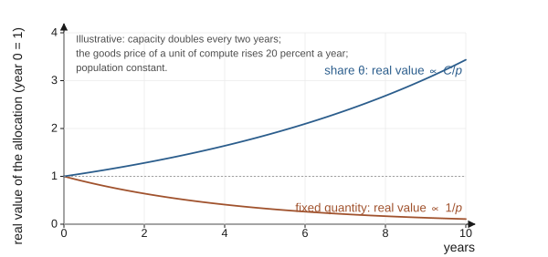
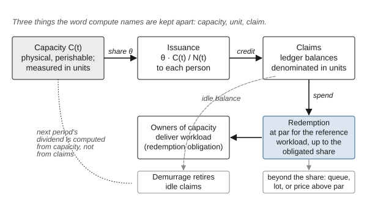
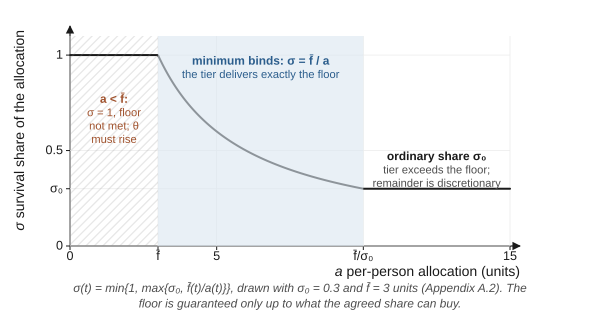
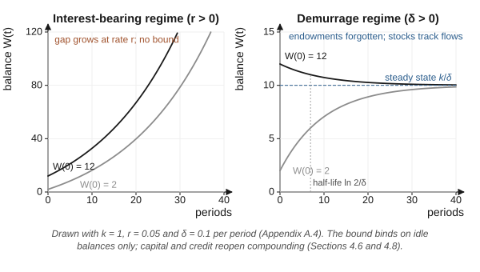
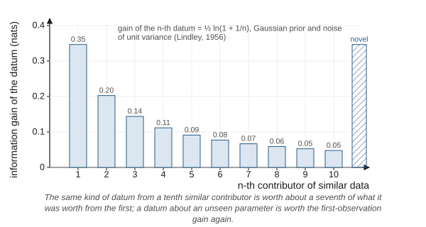
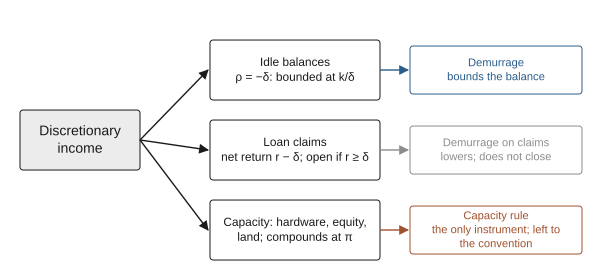

# Chapter 4: The Economic Layer: Compute as Currency

An exchange needs a medium. If people supply the data on which synthetic systems depend, and synthetic systems perform an increasing share of the work on which people depend, then the terms of exchange between them will be written, in practice, in whatever unit denominates their transactions. A unit issued and redeemed by one side gives that side control over the terms. A unit whose value depends on a political authority that one side can capture gives that control to whoever captures the authority. This chapter proposes a different unit, compute, and works through what it would take for a basic income paid in that unit to satisfy the three conditions of Chapter 3.

One presupposition should be stated at the outset, because every mechanism in the chapter rests on it and it has the same standing as the grounding assumption of Chapter 2. The framework presupposes an authority, whether a state or the convention's own institutions recognized by one, able to enforce three obligations: redemption of the unit by the owners of compute capacity (Section 4.4), acceptance of the survival tier by the providers of floor goods (Section 4.5), and whichever rule on capacity the convention adopts (Section 4.8). Section 5.9 names the minimal form of that presupposition, that existing states at least tolerate the framework's institutions, and Section 7.2 records that enforcement without a sovereign remains unsolved.

The chapter is organized around the difficulties the design must meet. Section 4.1 states what the currency is for. Sections 4.2 and 4.3 ask why compute, rather than some other unit, and how a unit of compute can be defined across physical substrates that do not share a common measure of speed. Section 4.4 addresses the indexing rule and the mechanics of issuance and settlement. Sections 4.5 and 4.6 take up distribution: the two-tier split and the demurrage charge on idle balances, which together are this framework's answer to the problem of concentration. Section 4.7 turns to the price of the data that people supply. Section 4.8 confronts the limit of every monetary remedy, the conversion of money into productive capital. Section 4.9 addresses a problem that recent events have made concrete: a unit of compute is worthless to a person whom compute cannot physically reach. Section 4.10 places the design in the international system, and Section 4.11 sets it against the empirical record on unconditional income. The chapter closes by testing the whole against the conditions of exit, consent and reciprocity.

## 4.1 What the currency is for

The basic income proposed here is not charity, and it is not primarily a response to technological unemployment, although it would serve as one. Its first function is the one identified by the formal analysis of Chapter 3: it is the mechanism by which every human party's disagreement payoff is raised to at least the floor, so that consent becomes possible and no one is forced by impatience to accept whatever terms are offered. Its second function follows from the grounding assumption. If synthetic systems need continuing human input in the domains where nothing else can supply it, then people who are economically secure and living full, varied lives are the source of that input. From the side of the systems that learn from such people, a basic income that sustains them also maintains a supply chain, which gives the operators of those systems, taken together, a reason to support it, though Proposition 4 shows that each has only a diluted reason of its own; it is not a reason for people to want it. That the security of the income improves the data people generate is a conjecture of this dissertation, not an established finding. Its third function is distributive in the ordinary sense. If an increasing share of economic output is produced by compute, then the income from compute will flow to whoever owns it unless some of it is deliberately shared. Economic models of transformative automation describe scenarios in which wages collapse when automation outpaces the accumulation of capital (Korinek & Suh, 2024), and theoretical work on the distributional effects of artificial intelligence shows that redistribution of the resulting rents can in principle compensate those who lose (Korinek & Stiglitz, 2019). A dividend on the automating factor is one such channel of compensation, and in the scenarios where wages collapse it would be not a supplement to wage income but the principal way most people receive any income at all.

Each of these functions constrains the design. The first requires that part of the income be inalienable. The second favors universality: a scheme that selected recipients by any observable criterion would correlate the supply of data with that criterion, and the diversity on which the value of human data partly depends is best secured by not selecting at all. The third requires that the income be indexed to the factor whose returns it shares, rather than fixed in a unit whose real value will drift.

The proposal enters a field that already contains other ideas for sharing the gains of automation, including resource dividends of the kind Alaska has paid since 1982 (Jones & Marinescu, 2022) and a range of proposals for sharing returns to capital more broadly. This dissertation does not survey that field; it engages the existing evidence on unconditional income in Section 4.11, and positioning the compute dividend systematically against its nearest alternatives remains future work.

## 4.2 Why compute

A currency for the exchange between people and synthetic systems must satisfy two requirements that pull in different directions. It must be something that the operators of synthetic systems cannot do without and cannot substitute, so that refusing it is costly to them, and something that people need as well. And it must not be under the control of either side, so that neither can manipulate the terms by manipulating the unit.

Company scrip fails the second requirement in a way that is instructive, though not in the way it is often described. The popular image of the indebted company-store miner is not supported by Fishback's quantitative evidence. In nonunion coalfields in the early twentieth century, company-store prices were generally close to those of nearby independent stores, miners were not typically in debt to the store, scrip functioned mainly as an advance on cash wages paid on payday, and the degree of exploitation varied with how much competition the mine faced for labor (Fishback, 1992). On this dissertation's reading of that evidence, what made scrip dangerous was not the scrip itself but the combination of an issuer with local market power and workers with limited exit. The inference that an issuer-controlled unit becomes an instrument of control where exit is absent is this dissertation's. The lesson for the present design is this: the problem with an issuer-controlled unit is not the unit but the issuer's power over what the unit buys, and the remedy is not merely a different unit but the guarantee of exit, which in monetary terms means redeemability with more than one provider.

Fiat money fails the first requirement in a different way. National currencies derive their value in part from the fact that states accept them in payment of taxes, a mechanism the record of Depression-era tax-anticipation scrip illustrates (Gatch, 2012), and, as a matter of law stated here without a source, from legal-tender rules that enforce their acceptance in settlement of debts. They are an instrument by which the operators of synthetic systems acquire what they cannot do without, compute, power and staff, rather than the thing they cannot do without. A national currency is therefore a unit in which the exchange between people and synthetic systems is mediated by a third party, the state, whose own relation to the systems is what is in question. That is not an argument against national currencies; it is an argument that they cannot by themselves constitute a medium for the exchange this dissertation is concerned with.

Compute satisfies the first requirement better than the other candidates considered here, scrip and fiat money; energy, the substrate-neutral input to which every unit of compute is tied, is a further candidate, and the comparison between the two is future work. Compute is the service exchanged, whereas energy is tied to it only by physical bounds that fix no conversion rate (Landauer, 1961; Lloyd, 2000); the efficiency achieved differs by hardware and improves over time (Hobbhahn et al., 2023). It satisfies the second requirement only conditionally, because the capacity behind the unit is owned by the principals of synthetic systems, and a unit they must redeem is, without the issuance, capital and access rules of Sections 4.4, 4.8 and 4.9, under their control. The bargaining argument for the floor does not depend on the unit. The case for compute rests on the properties that follow, together with indexing and the redemption obligation. It is scarce, measurable and needed by both parties: people need it for the services it provides, and the operators of synthetic systems cannot run a system without it. It is unusually quantifiable among the inputs to synthetic intelligence, and its physical form, concentrated in large and power-hungry data centers built from chips that can be counted, makes it detectable and excludable in a way that data and algorithms are not (Sastry et al., 2024). These are the properties that make compute an attractive lever for governance, and they are equally the properties that make it a plausible basis for a unit of account.

The theoretical status of such a unit deserves a precise statement, because it determines what can go wrong. This chapter treats a compute currency as a form of commodity money, in the sense that its value derives from the use value of the thing it represents, as the value of gold coin derived in part from the use value of gold. Commodity money has, on the record reviewed below, supplemented its intrinsic backing with an institutional one. In the United States during the Depression, tax-anticipation scrip, which local governments accepted in payment of taxes, circulated longer and in larger volume than stamp scrip, and its success has been linked to the view that money circulates because it can discharge an obligation people already owe (Gatch, 2012). A critical review of the Austrian town of Wörgl's experiment likewise attributes much of its circulation to the residents' large tax arrears, which the local currency could be used to pay (Greco, 2002; see also Fisher, 1933). Tax receivability worked on the demand side: holders already owed something that the unit could discharge. The analogue for the present design would be an obligation that participants must discharge in compute, such as the capacity-utilization charge of Section 4.8 or access fees for data payable only in the unit, and the convention of Chapter 5 decides whether any such obligation exists. The design's other institutional element works on the supply side. The *redemption obligation*, established by the convention, requires the owners of compute capacity operating under the framework to honor redemptions in compute; these are the principals of Section 3.3 where they own the capacity that runs their systems, and otherwise the capacity providers from which those principals rent. It gives the unit backing beneath its commodity value; it does not by itself create demand for the unit, which must come from the pricing of services in it and from whatever obligations the convention makes payable in it. The redemption obligation is the place where the governance layer and the economic layer meet.

## 4.3 Defining the unit

The name of the unit is *compute*. A person is paid in compute and a service is priced in compute, in the way that a dollar names a unit without naming the paper or metal in which it was once issued. The name deliberately avoids reference to any substrate. Alternatives considered during the development of this framework included a "quantum dollar," rejected because it builds into the name the assumption that quantum hardware will dominate, and a "shannon," rejected because it does not read as a unit of value. The choice matters because the definition the name stands for must survive changes in the hardware that delivers it.

That definition faces a difficulty. Raw processing speed is not comparable across substrates: operations per second on a silicon accelerator, coherence times and gate fidelities on a quantum processor, and the signaling rates of biological tissue in the organoid systems discussed in Chapter 8 are not quantities of the same kind. The working draft of this framework proposed to define the unit by the quantity of information processed, on the model of Shannon's (1948) demonstration that information can be measured independently of the medium that carries it. The analogy is instructive but limited. Shannon defined a unit of information, the bit, as a measure of selection among alternative messages; he explicitly set aside the meaning of messages as irrelevant to the engineering problem, and he did not define a unit of processing. Physics, moreover, ties processing to energy. Every logically irreversible operation dissipates a minimum quantity of heat (Landauer, 1961), and the maximum rate at which any physical system can perform operations is bounded by its energy (Lloyd, 2000). A unit of compute can be defined independently of substrate, but its cost cannot be.

The practical precedent for a substrate-neutral definition is not information theory but benchmarking. One benchmarking consortium in machine learning has confronted the problem of comparing radically different hardware with the following approach: a fixed set of reference workloads, each with a defined task and a target quality, and rules governing how systems may be configured to reach it. The MLPerf training benchmark measures performance as the time required to reach a target quality on a specified task, and its designers argue that fair comparison across diverse systems requires such rule-bound workloads, because identical code and settings cannot be imposed on radically different hardware (Mattson et al., 2020). Its companion benchmark for inference compares systems that span several orders of magnitude in power and performance under the same kind of rules (Reddi et al., 2020). Even a single floating-point operation is not a uniform unit; the throughput of the same accelerator differs by nearly an order of magnitude between numerical precisions (Hobbhahn et al., 2023).

The proposal therefore defines a unit of compute as the completion of one standard quantity of a reference workload to a specified quality, where the workload is a basket of representative tasks fixed by the convention of Chapter 5. The definition is substrate-neutral because any system that completes the workload to the required quality has delivered the unit, regardless of how. It is not physics-neutral, and it does not pretend to be: the energy and material cost of delivering a unit will differ by substrate and will fall over time. It also requires maintenance. A reference workload ages as the tasks people need change, in the way a consumer price index ages as the goods people buy change. The basket must be re-based periodically, and the authority to re-base it is a source of power that the governance layer must constrain. The benchmark problem is therefore not a technical detail to be solved once; it is a standing institutional function, and the authority that performs it holds power of the kind a central bank holds. Chapter 7 lists it among the limitations for that reason.

## 4.4 Allocation, indexing and issuance

The allocation rule is equal per person. The convention of Chapter 5 sets a share $\theta$ of the measured compute operating under the framework, which is the whole of global compute where all of it does, to be paid as basic income, and each enrolled person receives the fraction $\theta/N(t)$ of that compute in each cycle, where $N(t)$ is the number enrolled at the time of payment. Each person's percentage of the whole therefore falls as enrollment grows, while the share of the whole devoted to the income does not.

A fixed quantity of compute, paid each cycle, would lose value in a specific sense. Because the unit is commodity money, a claim on delivered workload, the quantity of compute that exists in a period is not an issuance choice but a consequence of physical capacity; what is issued is a claim on a share of it. The cost of a fixed quantity of compute has fallen fast: the price-performance of machine-learning accelerators has doubled roughly every two years (Hobbhahn et al., 2023), and the compute used to train milestone systems has grown with an estimated doubling time of under six months in the deep-learning era and about 10 months for the largest systems, though with wide uncertainty (Sevilla et al., 2022). Neither figure measures installed capacity, but both indicate that a fixed quantity of compute represents a shrinking share of what is available. As compute becomes more abundant, its price relative to everything that is not compute falls. A person paid a constant quantity of compute would find that it buys less and less of food, shelter and the other goods that compute is exchanged against: the loss is in the relative value of the unit, the counterpart of the rise in prices that the quantity theory predicts when money grows faster than the trade it finances (Fisher, 1911).

The remedy is to define the allocation as a share rather than a quantity. Appendix A shows formally that, holding $\theta$ fixed between re-basings of the reference workload, this converts the question of whether the income keeps its value into the question of whether the real purchasing power of all compute grows faster than population. A re-basing of the workload, which the convention that sets the share also controls, re-states what the share means and requires a conversion rule for outstanding claims; the two decisions must be taken together. For a framework whose premise is that compute is becoming the productive base of the economy, that is the right question. Whether the income keeps its value depends on whether the fall in compute's relative price is outweighed by the growth in its quantity, which holds if compute's share of the value of total output does not fall faster than output per person rises; the premise asserts this, and the design cannot ensure it. Figure 12 contrasts the two rules under illustrative growth.

**Figure 12**

*A Fixed Quantity of Compute Loses Real Value as Compute Grows Abundant; a Share Tracks the Real Purchasing Power of All Compute*

*Note.* Illustrative: capacity doubles every two years, the goods price of a unit of compute falls 20 percent a year (equivalently, p, the price of goods in compute units, rises 25 percent a year), and population is constant. A fixed quantity's real value is proportional to 1/p and falls; a fixed share's real value is proportional to C/p and rises while capacity grows faster than its relative price falls (Appendix A.2). The two-year doubling is the order of magnitude Hobbhahn et al. (2023) report for price-performance; the price path is an assumption.

The working draft of this framework rejected a "fixed-supply" alternative, on the model of currencies designed to resist inflation by capping issuance. That alternative is not available for a commodity unit whose supply is physical capacity. What is available, and what the design rejects, is paying a fixed quantity rather than a share, which would tie the income to the falling relative price of compute and reward those who hold the unit over those who use it.

**Issuance and settlement.** Three things that the word *compute* might name must be kept apart. *Capacity* is physical and perishable: capacity unused in a period is lost. The *unit* is the reference-workload measure of Section 4.3. A *claim* is a ledger balance denominated in units. With that vocabulary, four questions about the mechanics of the unit can be answered. First, who issues the claims? The dividend credits each person, in each period, with claims equal to $\theta/N(t)$ of the period's measured capacity, recorded on a settlement ledger maintained under the rules of the convention and assigned to persons rather than to the owners of the capacity. Second, what is a balance? A balance is a stock of claims, and a claim is redeemed when a provider delivers a service, priced in units, against it. The redemption obligation requires the owners of capacity operating under the framework to accept the unit at par for the reference workload, that is, to deliver one reference-workload-equivalent for each unit of claim, up to the share of their capacity that the convention sets; for other services the unit price is the provider's, so the obligation secures access to raw workload and not to any particular service. Two consequences follow. The share $\theta$ must not exceed the obligated share of the capacity operating under the framework; otherwise claims exceed redeemable capacity in every period, independently of saving, and where only part of global capacity operates under the framework the measured base from which claims are issued must be that part. And because balances accumulate across periods and capacity does not, outstanding claims can exceed the obligated share of a period's capacity even then, so the convention must choose a rule for redemption beyond that share: queued redemption, rationing by lot, or a rising unit price of services outside the obligated share, the last of which is redemption below par for the excess and should be named as such. Third, what happens to claims removed by demurrage? They are retired, reducing the stock of outstanding claims; the dividend in the next period is computed from capacity, not from the stock of claims, so retirement does not shrink the income. Fourth, how does lending work? Discretionary balances may be lent and borrowed. Loan claims denominated in the unit are recorded on the ledger and bear the holding cost described in Section 4.6, so that the charge falls on the lender's claim, paid out of the interest it receives or its own balance, and not on the borrower, whose debt is not reduced by it. This does not prevent lending at interest from compounding; it lowers the lender's net return to the interest rate less the demurrage rate, and Appendix A shows that accumulation through credit is bounded only if the interest rate is below the demurrage rate. A cap on the interest rate of ledger-recorded loan claims strictly below the demurrage rate would close the channel for the lending the ledger sees, at the cost of a negative net return on lending in the unit, though one less negative than holding; the design keeps credit in the discretionary tier and therefore leaves the credit channel open, so that closing it falls to the capacity rules of Section 4.8 and to the convention's ability to see credit extended off the ledger, which Chapter 7 records as a limitation. Figure 11 shows the circuit from capacity to claims to redemption.

**Figure 11**

*Capacity, Unit and Claim: How the Compute Dividend Is Issued, Redeemed and Retired*

*Note.* Capacity is physical and perishable; the unit is the reference-workload measure of Section 4.3; a claim is a ledger balance. A share θ of measured capacity is credited equally to the N persons enrolled, claims are redeemed at par for the reference workload up to the obligated share of capacity, and a rationing rule governs redemption beyond it. Demurrage retires idle claims; the next period's dividend is computed from capacity, not from the stock of claims.

## 4.5 Two tiers: the survival floor and the discretionary balance

Equal division is fair at the moment of payment. It is not fair over time unless something governs what happens between payments. If unused compute can be saved, lent, borrowed against or given away, ordinary economic behavior will reproduce the inequality of a market economy over time (Appendix A, Section A.4.1). Some people will under-consume and accumulate; others will overspend and fall into debt; the indebted will pledge future allocations; and a regime that began with perfect equality will converge on compute-rich and compute-poor households. This is not a defect peculiar to compute; it is the general behavior of any freely tradable unit. It means that equal allocation, by itself, cannot be presented as a solution to the problem of concentration.

The framework's response is to divide every allocation, automatically and at the source, into two tiers. The first, the *survival tier*, is earmarked for the floor goods defined in Chapter 3: power, water, food, shelter, basic communication and emergency care. It is non-tradable and non-borrowable, and it is spent on floor goods directly rather than passing through a spendable balance. The second, the *discretionary tier*, is the remainder. It is freely tradable, can be saved, lent and borrowed, and is subject to the holding cost described in the next section.

Five features of this design require defense.

**The split is a percentage, with a binding physical minimum.** The two tiers are proportions $\sigma$ and $1-\sigma$ of an allocation that is itself a share of global compute, so both scale automatically as total compute grows. A floor defined physically, however, cannot be secured by a percentage alone. The survival tier delivers the floor only if its value, $\sigma\theta C(t)/N(t)$ units at the compute price of floor goods, is at least the value of the floor bundle, and nothing in the arithmetic of percentages guarantees that it will be. The rule is therefore a percentage with a binding minimum. In ordinary times the tier is the fixed proportion $\sigma$ ($\sigma_0$ in Appendix A); when that proportion would fall short of the floor, the survival share rises until it does not, drawing on the discretionary tier. If the whole allocation falls short of the floor, the rule cannot be met without raising $\theta$, which is a decision the convention must take (Appendix A, Section A.2); the design therefore guarantees the floor only up to what the agreed share of capacity can buy. Because the compute price of floor goods will differ by place, an inference this dissertation draws from the unequal geography of compute described in Section 4.9, a floor that is equal in physical terms requires a survival share that differs by place; the design accepts unequal survival shares in exchange for an equal floor, the discretionary tier absorbs the difference, and Appendix A writes the single-place case. This reintroduces a quantity that someone must define, the floor standard, and the floor standard becomes the contested parameter that a percentage rule was meant to avoid. The design's answer is to specify the standard itself by rule rather than by figure, as an evolving level of service set relative to what the technology of the time delivers to the best-served, rather than frozen at what was possible when the rule was written. There is a legal precedent for the principle in another domain. United States telecommunications law defines universal service as an evolving level of service, periodically redefined as technology advances, and lists among its principles that services in rural and high-cost areas should be reasonably comparable to those in urban areas (Universal service, 47 U.S.C. § 254, 2018). Chapter 5 returns to the governance of the floor standard, and Chapter 7 records it as a limitation. Figure 13 plots the rule.

**Figure 13**

*The Survival Share Is a Percentage With a Binding Physical Minimum*

*Note.* σ(t) = min{1, max{σ₀, f̄(t)/a(t)}}, drawn with σ₀ = 0.3 and f̄ = 3 units (Appendix A.2). Where the whole allocation falls short of the floor the share is one and the floor cannot be met without raising θ; where the allocation is modest the minimum binds and the tier delivers exactly the floor; where it is ample the ordinary share applies and the remainder is discretionary.

**The survival tier is inalienable.** Chapter 3 gave the formal argument: a floor that can be sold or pledged stops being a floor at the moment it is needed, and those most likely to pledge it are those in the most acute need. Legal theory has a name for an entitlement that may not be transferred even with the holder's consent, an inalienability rule (Calabresi & Melamed, 1972, p. 1092), and there is a sustained philosophical defense of making certain goods market-inalienable where their commodification threatens personhood (Radin, 1987). The economic literature on in-kind and earmarked transfers surveys several rationales for them: the Samaritan's dilemma, in which a society that will not allow people to go without power or water creates an incentive to under-provide for oneself; self-targeting; and considerations of political economy. It concludes that paternalism and interdependent preferences are the leading explanations of the transfers actually observed (Currie & Gahvari, 2008). This design does not rest primarily on paternalism. Its rationale is the bargaining-theoretic one of Chapter 3: the earmark protects a disagreement payoff, not a judgment about how people should spend. It does not restrict what people may do with the discretionary tier. It does restrict the survival tier to a fixed bundle of goods that every person needs, and the next paragraph defends that restriction against the canonical objection.

**The survival tier is restricted to floor goods.** This departs from the canonical definition of basic income as an unconditional cash payment. The leading philosophical case for basic income treats unconditionality and payment in cash as part of what makes the income an instrument of freedom (Van Parijs & Vanderborght, 2017). In an earlier statement of the same position, Van Parijs defined basic income as paid in cash rather than in kind, without restriction on the nature or timing of the consumption or investment it funds, and set it explicitly against a special currency with restricted uses, or one that must be consumed in the current period without any possibility of saving, as in Duboin's "distributive economy" (Van Parijs, 2006, p. 8). The survival tier is, in two respects, exactly what that definition excludes: it is spendable only on floor goods, and it cannot be saved against or borrowed on. The two-tier design therefore does not claim to satisfy the canonical definition. It keeps unconditionality, since no one must work or prove need to receive either tier, and departs from fungibility for a part of the income only, leaving the discretionary tier unrestricted as to use, though, under the demurrage of Section 4.6, not costless to hold; that too is a departure from the canonical definition, and it is defended there. The defense is that the fungibility of the floor is what allows it to be bargained away, and that a floor that can be bargained away does not secure the freedom it is meant to secure. A defender of the canonical view can reply that a restricted floor is a judgment about what people need, made for them; the reply of this framework is that the floor bundle is fixed narrowly, to goods without which no other choice can be made, so that the restriction binds only where the freedom it limits is the freedom to fall below the point at which freedom can be exercised at all. Whether that reply succeeds is a question on which reasonable people committed to real freedom can disagree. The design has a cost, and experimental evidence shows what it is. In a randomized study of unconditional transfers in Kenya, monthly transfers improved food security more than lump sums, while lump sums were more often invested in durable goods (Haushofer & Shapiro, 2016). A steady, non-advanceable floor captures the first benefit; the second is what advanceability buys. The design assigns it to the discretionary tier, which can be saved and borrowed against, and accepts that the survival tier forgoes it.

**The survival tier requires more than one provider.** The lesson of company scrip, as Section 4.2 described it, is that a unit redeemable with only one issuer is dangerous in proportion to the issuer's market power. An earmarked tier spendable only with a single provider of floor goods would recreate that danger in full. The survival tier must therefore be redeemable with any qualified provider of floor goods, and portability between providers is a condition of the tier's legitimacy, not an optional refinement.

**Delivery of the floor goods that are not compute.** Of the floor goods, only communication and part of emergency care are compute services, and the only obligation the design creates is on owners of compute capacity to deliver compute. Nothing stated so far obliges a farmer, a utility, a landlord or a clinic to accept the survival tier. The tier delivers the whole floor as a disagreement payoff in one of two ways. The first is an acceptance obligation on providers of floor goods operating under the framework, which is a legal-tender rule of the kind Section 4.2 described as the institutional backing of fiat money and should be named as one; it creates a guaranteed buyer with a fixed bundle, and where sellers are few it gives them price-setting power over the floor bundle, driving the survival share toward the whole allocation (Appendix A.2), which is the company-store problem at the level of the floor itself and which only competition among providers, and whatever rule on the floor bundle's price the convention adopts, can contain. The second is to rely on markets in which floor goods are already priced and sold in the unit, in which case the floor is guaranteed only for the goods compute can deliver and the rest is a limitation. The design adopts the first. It therefore presupposes the enforcing authority stated at the head of this chapter, which is the external condition Section 5.9 names under Ostrom's seventh principle and the reason Chapter 6 begins the transition with a nationally legislated floor. A further circularity should be stated: where the counterparty in a bargain is itself an owner of capacity, the person's income on impasse is delivered by the party it is at impasse with, and the tier functions as a disagreement payoff against that provider only where the provider is not the sole channel of its redemption. Chapter 7 records both points. The history of universal service supplies a further warning: in the early American telephone industry, "universal service" was first a slogan for consolidating a single interconnected system, and only much later came to mean a telephone in every home (Mueller, 1997). An entitlement designed to secure access can, if it is tied to a single network, become the instrument by which that network entrenches itself.

The two-tier design achieves something limited. It confines the inequality that free exchange produces to the discretionary tier and prevents that inequality from reaching survival itself. It does not prevent concentration within the discretionary tier.

## 4.6 Demurrage

A person whose services or output are in high demand can accumulate discretionary compute faster than they spend it. A person who persuades others to transfer their discretionary balances to them can accumulate faster still. Large holdings confer bargaining power, as Chapter 3 argued, because a party that can afford to wait can hold out for better terms. The question is whether the framework can make the passive accumulation of large balances costly without confiscating anything and without a central authority deciding how much is too much.

The proposed answer is demurrage: discretionary compute loses a small percentage of its value for each period it sits unspent. Demurrage is a holding cost on idle balances, and on outstanding loan claims, not a tax on transactions.

**The idea and its history.** The proposal is most closely associated with Silvio Gesell, whose *The Natural Economic Order*, published under that title in German in 1916 from works first issued in 1906 and 1911, argued that money should deteriorate like other goods, so that holding it would cease to be costless and money would circulate rather than be hoarded (Gesell, 1916/1958, pp. 33–34). Keynes endorsed the idea in the *General Theory*, where he described Gesell as a prophet whose work had been unduly neglected and judged that the idea behind stamped money was sound; he also identified its central weakness, which was that money is not the only asset with a liquidity premium, so that a holding cost on currency would drive holders into substitutes such as bank deposits, foreign money, precious metals and land (Keynes, 1936, Chapter 23). Gesell's program paired demurrage with the nationalization of land; as Keynes observed, that removes one substitute for money but not the others. Irving Fisher championed a temporary form of stamp scrip as a Depression remedy (Fisher, 1933).

The trial most often discussed took place in Wörgl, a small town in the Austrian Tyrol, in 1932 and 1933, where the municipality issued labor certificates that lost 1 percent of their value each month unless a stamp was purchased, and used them to finance public works. The experiment is often described as having reduced local unemployment by a quarter (Gelleri, 2009), a figure September (2026) traces to movement sources. The evidence does not support so strong a claim. The commonly repeated figures trace to secondary sources, including a movement publication and a diploma thesis, rather than to audited series; the daily exchange records were later destroyed; and a recent scholarly review concludes that the loss of the records leaves the question of what the experiment achieved largely open (September, 2026). Fisher, a sympathetic contemporary, recorded that permanent jobs went to only some 30 to 50 of the unemployed (Fisher, 1933, Chapter 4). The public works were financed in part by outside subsidies and a provincial credit, and the scrip's acceptance owed much to its use in paying tax arrears, so that whether demurrage itself caused the observed improvements is disputed (Greco, 2002). What is not disputed is that the experiment was halted by the authorities. The Austrian National Bank objected that the town was infringing its monopoly of issue (Ottacher, 2007, pp. 53–54); the certificates were withdrawn from circulation in September 1933 under administrative order and threat of police enforcement, the sources differing on the day (Ottacher, 2007, p. 57; September, 2026); and the Administrative Court dismissed the town's final appeal on 18 November 1933 (Champ, 2008; Ottacher, 2007, pp. 58–59). Appendix C records the discrepancies among the sources, including the Vienna exhibition's account (Institut für Wirtschafts- und Sozialgeschichte, Wirtschaftsuniversität Wien, n.d.), on the date and on which authority ended circulation. Attempts to scale stamp scrip in the United States largely failed, because of business reluctance to accept it, problems of coordination, and the inconvenience of affixing stamps to paper notes, which made the scrip unattractive as soon as ordinary money was available (Champ, 2008). Modern local currencies with demurrage have operated for years at small scale (Gelleri, 2009, an account by the currency's founder), but one review of the evidence suggests that the demurrage rate is not decisive for how much such currencies are used (Godschalk, 2012).

**What the historical record does and does not show.** Two conclusions follow. First, the case for demurrage in this framework cannot rest on the claim that it stimulates spending and employment, because the evidence for that claim is weak. Second, the practical objection that defeated paper stamp scrip, the transaction cost of applying the charge, does not apply to a ledger-based unit. Goodfriend (2000) analyzed a carry tax on electronic bank reserves as an instrument of monetary policy at the zero lower bound, and mainstream macroeconomic theory has treated a Gesell-style carry tax on currency as a legitimate instrument, though for the purpose of escaping the zero lower bound on interest rates rather than for redistribution (Buiter & Panigirtzoglou, 2003).

**The distributive case.** The argument for demurrage here is distributive, and it is made precise in Appendix A. Under a regime in which balances earn a positive return, a constant net inflow produces a balance that grows without bound, and two people with the same income but different starting wealth diverge exponentially in absolute terms (the gap between their balances grows at the rate of return, while under demurrage it decays to zero), a dynamic analogous to the one Piketty (2014) identified in the tendency of inherited wealth to dominate when the return on capital exceeds the rate of growth. Under demurrage, the same constant inflow produces a balance that converges to a ceiling equal to the net inflow divided by the demurrage rate. Three consequences follow. Accumulation in idle balances is bounded. Initial endowments decay: at a demurrage rate of 1 percent a month, an idle windfall loses half its value in a little under six years. And in the long run, differences in holdings reduce to differences in current net inflow, meaning income less spending. Demurrage does not abolish inequality. It removes the compounding of inequality within balances, so that the distribution of balances tracks what people currently earn and choose not to spend, rather than the history of who happened to accumulate first. Figure 14 shows the two regimes.

**Figure 14**

*Idle Balances Compound Under Interest and Converge Under Demurrage*

*Note.* Two parties with the same constant net inflow k and different starting balances, drawn with k = 1, r = 0.05 and δ = 0.1 per period (Appendix A.4). Under a positive return their balances grow without bound and the gap between them grows; under demurrage both converge to k/δ, the difference in endowments decaying with half-life ln 2/δ. The bound binds on idle balances only; capital and credit reopen compounding (Sections 4.6 and 4.8).

**Why demurrage suits compute.** One might argue that an unspent compute balance represents idle capacity in a way that unspent cash never did. That argument does not hold as it stands: because a balance is a claim on future capacity, the hardware itself may be fully used by others while the claim sits unspent. The real connection between demurrage and idle capacity runs through the capacity rules of Section 4.8. Demurrage on claims keeps the stock of outstanding claims from piling up against a perishable resource, and a utilization charge on capacity, if the convention adopts one, ensures that hardware itself does not sit idle. Together they align the private cost of holding with the social cost of idleness; neither does so alone.

**The limits of demurrage.** Demurrage does not fully solve the concentration problem, for three reasons. The first is the one the formal model makes exact: a person whose output is in persistent high demand sustains a large balance because their net inflow is large, and demurrage can only cap that balance relative to the inflow, not eliminate it. The second is credit: lending at interest above the demurrage rate reopens compounding, as Section 4.4 stated. The third is Keynes's substitution objection, which applies without qualification. A holder facing a carrying cost on compute balances will convert them into assets that do not bear it: hardware, equity in compute providers, land. Section 4.8 takes up this third problem directly. Taken together, the three limits mean that demurrage has no distributive effect of its own in an economy with capital and credit: a holder converts idle claims into whatever asset bears no holding cost, and the bound of Appendix A then binds on balances no one keeps beyond transaction needs. Its effect is conditional on the capacity rules of Section 4.8 and on an interest rate below the demurrage rate. Because outstanding loan claims bear the same charge as idle balances, a lender compares lending with holding rather than with a zero return, so lending at a positive rate below the demurrage rate can arise unaided, which is the effect Gesell expected a carrying cost on money to have on the rate of interest (Keynes, 1936, Chapter 23). A holder who can instead buy capacity that bears no charge will not lend for less than capacity returns, however, so whether rates fall below the demurrage rate depends on the capacity rules; this is the dissertation's inference. Because the design keeps credit in the unit, the credit channel stays open and the capacity rules carry the whole burden. What demurrage does accomplish, under those rules, is to convert passive hoarding from a costless default into an active cost. That is the role this framework assigns to it, and no more.

## 4.7 Pricing human data

If human data is an input that synthetic systems need, it has a price, and the way that price is set will shape the lives of those who supply it.

One design would pay more for data from lives that are interesting to people: astronauts, inventors, public figures. That design would reproduce in the data economy the logic of markets for attention, in which income follows visibility. It would pressure people to perform novelty for the sake of payment, which corrupts the consent condition by making the content of a life a function of its marketability.

The alternative prices data by how much it reduces a model's uncertainty. Both designs reward novelty. The difference is the reference point: the attention design rewards novelty as judged by other people, which can be performed; information-gain pricing rewards novelty as judged by the model's current uncertainty, which cannot be performed in the same way but can be fabricated (the fifth qualification below) and which declines for each further contributor of similar data. This is not a novel proposal but the application of a long-established idea. The expected information an experiment provides, measured as the expected reduction in uncertainty about a model's parameters, was introduced into statistics as a criterion for experimental design (Lindley, 1956), was adapted as an objective for choosing which data a neural network should learn from (MacKay, 1992), and underlies several of the strategies of active learning, in which a learner selects the examples that will most reduce its uncertainty (Settles, 2009). It has also been proposed as the basis for rewarding data contributors. In one such scheme, the value of a coalition of contributors' data is its information gain about a model's parameters, each contributor's share is set by the Shapley value of the resulting cooperative game, and contributors are rewarded with access to models of differing quality rather than with money (Sim et al., 2020). The step from rewarding contributors in models to paying them in a currency is this dissertation's. On this measure, the undersampled everyday life of a dairy farmer may be worth more to a model than a further memoir by a public figure. The price follows informational novelty to the model, not social status among people.

Six qualifications must accompany this proposal.

First, information gain is defined only for a model that maintains a probability distribution over its parameters, and the quantity priced is the reduction in that uncertainty that a datum produces once it is observed: the realized form of the expected-information criterion. Large models trained to a point estimate carry no such distribution, and the price can be computed for them only through an approximation, which the governance layer must choose and which is itself a contested parameter.

Second, information gain is relative to what the model already believes. A datum is novel only against a prior, and a model whose hypothesis space is wrong may misvalue data, because information-based criteria estimate a datum's usefulness on the assumption that the model is correct, which the original formulation of information-based data selection flagged as possibly their main weakness (MacKay, 1992, pp. 590, 602–603). Information-gain pricing therefore rewards novelty as the model perceives it, which is not the same as novelty in the world.

Third, information gain is one of several defensible valuations. Alternative approaches value a datum by its marginal contribution to a model's performance on a validation task, using the Shapley value to divide credit fairly (Ghorbani & Zou, 2019; Jia et al., 2019). These methods answer a different question, how much a datum improves performance rather than how much it reduces uncertainty, and they produce different prices. The choice between them is not merely technical; it is a choice about what the exchange is for, and it belongs to the governance layer.

Fourth, data is freely replicable and its value is combinatorial: a datum's contribution depends on what other data it is combined with, and the same datum sold twice does not lose value to the seller. These properties make data markets difficult to design, and the mechanism-design response has been to construct markets specifically to achieve truthful pricing and a fair division of revenue among sellers (Agarwal et al., 2019).

Fifth, any scheme that pays for data creates an incentive to manufacture what it pays for. Methods that trace a model's predictions to the training points most responsible for them have also been used to craft training data designed to manipulate a model (Koh & Liang, 2017). A scheme that pays for novelty will attract fabricated novelty, and the payment mechanism must be robust to it.

Sixth, and most important for the theory, the data that reduces a model's uncertainty most may be data that tells it the most about people other than its source. Chapter 3 called the set of people about whom a flow licenses inference its informational shadow, and conjectured that where a model's parameters describe populations, the price of a flow under information-gain pricing and the inadequacy of individual consent for that flow will tend to rise together. If the conjecture holds, the highest-priced data is the data for which individual consent matters least, and a data market built on information-gain pricing must be governed collectively. Even if it holds only partly, it is a strong reason why the economic layer cannot stand without the governance layer of Chapter 5. Chapter 7 adds a further cost: a price that rises with what data reveals is a price that rewards revelation, and so creates pressure against privacy. Figure 15 shows the declining gain from similar data.

**Figure 15**

*Under Information-Gain Pricing the Price of Each Further Similar Datum Falls*

*Note.* For a model estimating a parameter with a Gaussian prior and observation noise of unit variance, the n-th similar datum adds ½ ln(1 + 1/n) nats, the realized form of the expected-information criterion (Lindley, 1956). A datum about a parameter the model has not seen adds the first-observation gain again. The price follows novelty to the model, not status among people; the first qualification of Section 4.7 states what this computation presupposes.

## 4.8 Capital: concentration through ownership of capacity

Demurrage acts on balances and claims. It does not act on assets. A person who accumulates discretionary compute and converts it into compute-generating capacity, by buying hardware, financing a data center, or acquiring equity in a provider, escapes the holding cost and acquires an income stream that compounds. Appendix A shows that reinvested returns on such capacity grow at the rate of return, which reopens the channel that demurrage closes. The substitution Keynes raised against Gesell (Keynes, 1936) is, in this setting, the principal route by which concentration would proceed.

The concern is not speculative. Several layers of the contemporary technology stack on which synthetic intelligence depends are highly concentrated, including advanced chips, cloud infrastructure and the most capable models (Narechania & Sitaraman, 2024). The economics of the most capable foundation models tend toward natural monopoly at the frontier, with intense competition behind it (Vipra & Korinek, 2023). A background paper of the OECD Secretariat describes artificial-intelligence compute markets as combining high concentration, high barriers to entry, vertical integration and demand outstripping supply, while noting that enforcement has so far been limited (OECD, 2025). An index of government-backed sovereign AI projects, tracking 184 of them across 67 countries by mid-2026, reports that among model projects that disclose their base, most fine-tune foreign open-weight models, though efforts to train models from scratch are rising, and that only a handful of jurisdictions operate programs across compute, models and data together (Chavez et al., 2026).

A rule that acts on capacity rather than on balances is the natural complement. Three candidates are available, each with costs.

A *capacity-utilization charge* would extend the holding cost to compute-generating capacity itself, so that idle hardware, like an idle claim, bears a cost. This aligns private incentives with the social cost of idle capacity but would discourage the reserve capacity that reliable services require.

A *cap on individually held capacity* would limit how much compute-generating capacity any single person or organization may own. It is simple to state and difficult to enforce, since ownership can be structured through intermediaries.

*Collective ownership above a threshold* would place compute-generating capacity above some scale in cooperative or public hands, on the model of the network, platform and utility tools that antimonopoly scholars propose for concentrated technology layers: structural separation, nondiscrimination and open access, public options, and cooperative governance (Narechania & Sitaraman, 2024). To the author's knowledge there is no close precedent for collective ownership above a threshold. The nearest related precedent, the rural electrification program of Section 4.9, created cooperatively owned capacity alongside incumbents rather than transferring incumbents' capacity.

All three instruments require enforcement against owners of capacity, and so does the redemption obligation itself; Chapter 5 argues that the framework cannot assume sovereign enforcement, and the difference among the instruments is in how easily each is evaded. A cap is the easiest to structure around through intermediaries; a utilization charge and collective ownership attach to physical capacity that is detectable and countable (Sastry et al., 2024).

This dissertation does not choose among these instruments. It argues that one of them, or a combination, is a necessary complement to demurrage, and that the choice belongs to the convention of Chapter 5 because it allocates power. What it does claim is that no purely monetary design can solve a concentration problem whose ultimate source is the ownership of productive capacity. Chapter 7 records this as a limitation. Figure 16 shows the three channels and the instrument that acts on each.

**Figure 16**

*Three Channels of Accumulation and the Instrument That Acts on Each*

*Note.* Demurrage bounds idle balances; demurrage on loan claims lowers the lender's net return to r − δ without closing the channel; only a rule on capacity acts on the conversion of balances into compute-generating capacity, and the design leaves that rule to the convention. Without it, holders convert balances into capacity and the demurrage bound binds on nothing (Section 4.6).

## 4.9 Physical access

A share of global compute is an accounting entry unless the compute it represents can reach the person who holds it. Recent events have made the problem concrete.

Memory is the clearest case. In December 2025, Micron Technology, a major memory manufacturer, announced that it would exit its consumer memory and storage business in order to direct supply to larger strategic customers in faster-growing segments, citing demand from data centers serving synthetic-intelligence workloads (Micron Technology, 2025). An industry estimate relayed by market analysts projected that synthetic-intelligence applications would account for nearly a fifth of global DRAM wafer capacity in 2026, measured in wafer-equivalent terms (TrendForce, 2025). By late 2026, analysts reported that memory suppliers continued to prioritize advanced production capacity for server products, that contract prices for conventional memory continued to rise, that makers of personal computers were cutting storage capacities to contain costs, and that rising memory costs were suppressing smartphone production (TrendForce, 2026a), while high-bandwidth memory for data-center accelerators and conventional memory competed for the same limited wafer capacity (TrendForce, 2026b). On these reports, the same upstream wafer capacity serves both consumer hardware and data-center infrastructure (TrendForce, 2026b), in a market the OECD describes as concentrated (OECD, 2025). The inference that, in the absence of any countervailing obligation, that capacity flows to whichever buyer pays most, at present the data-center build-out, is this dissertation's.

The geography of compute compounds the problem. A census of hyperscale cloud regions finds that public cloud compute suited to training large models is concentrated in a small number of countries, that many others host only infrastructure suited to deploying models, and that a large part of the world hosts no such public cloud compute at all (Lehdonvirta et al., 2024). A compute dividend issued equally to every person would therefore be redeemable very unequally depending on where that person lives.

This makes physical delivery, and not only monetary accounting, part of the exchange that the three conditions govern. A currency that cannot be spent because the resource it represents never reaches the holder fails the reciprocity condition in substance, whatever it promises in form. It also fails the exit condition, because a person who cannot obtain compute directly is dependent on whatever intermediary can.

The framework's proposal is that the build-out that the economic layer requires also finance a global, non-exclusive compute-delivery network: fiber and last-mile access guaranteeing every participant a baseline level of compute service. The baseline should be specified as a service level, not a connection: sufficient bandwidth, latency and reliability to deliver, in any inhabited place, the compute services through which the survival tier is redeemed, including basic communication and the remote component of emergency care, and to redeem the tier with more than one provider. Whether the delivery standard should exceed the floor, toward the class of services a person in a well-served city can obtain, is a choice for the convention, financed from the discretionary side of the build-out. As with the survival tier, the standard should be an evolving one, redefined as technology advances. The financing has to have an agent. The precedent in United States telecommunications law is a mandatory contribution from every provider to a support mechanism (Universal service, 47 U.S.C. § 254, 2018); the analogue here is a contribution from every provider operating under the framework, administered by the convention's institutions and lent to member-owned cooperatives. Where no such authority exists, the proposal depends on national governments adopting it, which Chapter 7 records as a limitation.

The historical model is the rural electrification program of the New Deal. In 1930 fewer than one American farm household in ten had electricity (Lewis & Severnini, 2020). The Rural Electrification Administration made low-interest loans to member-owned cooperatives that built lines to farms. The number of electrified farm homes roughly doubled within five years; the loans significantly raised crop output and crop productivity and helped prevent declines in overall farm output and land values; and because nearly all loans were repaid, the final cost to taxpayers was relatively low, although the program's effects outside agriculture were much smaller (Kitchens & Fishback, 2015). By 1960 farm electrification was nearly universal, and the benefits exceeded the historical costs even in sparsely populated areas (Lewis & Severnini, 2020). The feature of the precedent worth emphasizing is that it worked through credit to cooperatives owned by the people they served, not through grants to incumbents. A compute-delivery build-out at global scale would also require a vast amount of physical labor, much of it of the unstructured, physically situated kind that has resisted automation (Autor, 2015, p. 11). That is this dissertation's inference rather than a lesson of the precedent, but it links the proposal to the problem of automation-driven unemployment discussed in Chapter 6 and to the argument from structural interdependence in Chapter 5.

The precedent also carries a warning. The OECD Secretariat flags large public construction tenders for data-center, fiber and energy infrastructure, especially those with compressed timelines, as settings that invite bid-rigging (OECD, 2025). A build-out designed to secure access can be captured at the procurement stage by the same concentrated interests it was meant to counter. Procurement design is therefore part of the proposal, not an administrative afterthought.

## 4.10 Nations, cultures and the global unit

The final element of the economic layer is a working hypothesis about the international system, and it is offered as a hypothesis rather than a conclusion. As synthetic systems become the medium through which people obtain information, services and much of their cultural experience, political communities may come to be defined less by territory and more by the system that serves their language, law and culture. Each such community would have its own compute budget, and exchange between communities would take place at rates set in the shared unit.

Governments across dozens of countries are funding sovereign AI projects (Chavez et al., 2026). That is evidence that political communities are beginning to seek systems of their own, not that communities are forming around systems rather than territory, which remains the hypothesis. The same evidence documents the central obstacle. Among the model projects that disclose their foundations, most build on models developed elsewhere (Chavez et al., 2026), and the public cloud compute suited to developing models is concentrated in a few countries (Lehdonvirta et al., 2024). A world of culture-specific systems exchanging in a common unit would inherit, at the level of nations, every concentration problem this chapter has described at the level of persons. The commons-governance literature discussed in Chapter 5, which emphasizes nested enterprises in which local units govern local matters within larger shared rules, offers the most promising framework for such a structure, but it does not by itself dissolve the inequality in starting positions. Compute inequality between nations is therefore the main objection to this element of the design, and it is treated here as a central tension.

## 4.11 What the evidence on unconditional income suggests

No society has paid a basic income in compute. A substantial body of evidence exists, however, on unconditional cash transfers, and it bears on the two questions most often raised against any basic income: whether it causes inflation and whether it causes people to stop working.

On inflation, the largest randomized study of which this dissertation is aware was conducted in rural Kenya, in which one-time transfers equivalent to more than 15 percent of local output were distributed across hundreds of villages. The study found large gains in consumption and assets for recipients, substantial spillover benefits for non-recipients, a local multiplier of roughly 2.5, and price increases of about 0.1 percent on average (Egger et al., 2022). The result is favorable to the proposal but bounded: the authors report suggestive, indirect evidence of slack capacity among local firms, which may partly account for the large multiplier. The relevant question for a compute dividend is the elasticity of compute supply as a whole, how quickly capacity can expand to meet new demand. The memory shortages described in Section 4.9 are a sector-specific shock rather than a test of that question, but they are a reminder that compute supply does not expand without friction.

On work, the evidence is mixed in a way that should temper strong claims on either side. A permanent, universal dividend in the state of Alaska, paid since 1982, has had no detectable effect on overall employment and has modestly increased part-time work (Jones & Marinescu, 2022). In the first year of Finland's two-year experiment, replacing minimum unemployment benefits with an unconditional payment of the same size left days in employment statistically unchanged, despite a 23-percentage-point cut in the participation tax rate for full-time work (Verho et al., 2022). A large randomized study in two American states, reported in a working paper not yet peer-reviewed, in which recipients received 1,000 dollars a month for three years, found a moderate reduction in work: labor-force participation fell by about 4 percentage points and hours by one to two a week, leisure was the largest gain in time use, and gains in subjective well-being faded after the first year (Vivalt et al., 2024). A review of basic-income proposals for advanced economies concludes that a universal income large enough to substantially raise the incomes of the poor would be very expensive, and that it would redirect transfers toward households that current programs do not target (Hoynes & Rothstein, 2019).

Two observations place this evidence in the context of the present design. First, the cost objection is framed for an income financed by taxation of a labor economy. The compute dividend is financed differently, as a share of the productive capacity that, in the scenarios motivating it, is displacing labor as the source of output. Whether that financing is feasible depends on the political economy of the transition (Chapter 6) and the governance of the share (Chapter 5), not on the fiscal arithmetic of existing welfare states. This dissertation offers no estimate of the share $\theta$ that would deliver the floor, nor of the cost of the delivery network of Section 4.9; both are questions of magnitude that the design raises and that future work must answer before the proposal can be judged affordable. Second, the labor-supply evidence matters less to this framework than to most basic-income proposals, because the framework does not depend on the income inducing or preserving employment. It depends on the income securing a floor beneath every person's bargaining position. Whether a reduction in hours reflects the refusal of bad terms or the purchase of leisure cannot be read from the labor-supply evidence; Vivalt et al. (2024) detect no gain in job quality. From the standpoint of the exit condition the relevant outcome is the ability to refuse, which none of these studies measures directly.

## 4.12 The economic layer against the three conditions

Chapter 3 asked that every proposal be tested against exit, consent and reciprocity. The economic layer fares as follows.

**Exit.** The survival tier, with its binding minimum, raises every person's disagreement payoff to the floor wherever the agreed share of capacity can buy it and the floor goods can be obtained for the unit (Section 4.5), and makes it inalienable, which is the formal precondition of exit. Redeemability with multiple providers reduces the risk that the floor becomes a company store. The physical-access program, where it is adopted, is designed to make the floor deliverable. Exit at the level of capital, the ability to escape dependence on concentrated owners of compute capacity, is secured only if the capacity rules of Section 4.8 are adopted.

**Consent.** With the floor secured, refusal no longer threatens survival, which satisfies the clause of the consent condition that depends on exit. The informational clause, that people understand what they are agreeing to, is not addressed by the economic layer and must be secured through the transparency requirements of the governance layer.

**Reciprocity.** Information-gain pricing, or whichever valuation the governance layer adopts, gives the value of a flow a definition that can be made legible; it ties compensation to that value only where the flow's shadow does not extend beyond its source. The redemption obligation binds the owners of capacity operating under the framework to deliver reference workload against the unit, at par and up to the obligated share. Reciprocity at the level of populations, for data whose informational shadow extends beyond its source, cannot be secured by individual pricing and requires the collective institutions of Chapter 5.

The economic layer, in other words, is necessary and insufficient. It builds the floor and prices the flows. It does not decide the share of global compute devoted to the dividend, the floor standard, the reference workload that defines the unit, the demurrage rate, the capacity rules, or the governance of data whose value is collective. Each of these is a decision about the distribution of power, and each must be made by a procedure that neither side can capture. That procedure is the subject of the next chapter.
